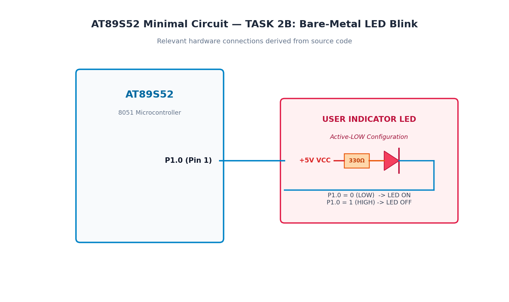

# EXPERIMENT DETAILS

**EXP:** CONTINUOUS ASSESSMENT 2

**DATE:** 20/07/2026 (Week 2)

**NAME OF EXP:** 8051 Tool Chain Setup – Development Board – AT89S52

**HARDWARE SETUP / PLATFORM:** AT89S52 development board — Keil µVision 5 (C51)

---

## TASK 1 : Hardware Board Bring-Up

### 1. Circuit Diagram

| Signal | Pin | Description |
|---|---|---|
| User LED | P1.0 | On-board indicator, **active-LOW** (`0` = ON) |
| GPIO output | P1.0 (Pin 1) | LED connection, active-LOW |

### 2. Core Logic / Pseudocode / Code Base

**How it works**

Before loading firmware, verify that the AT89S52 has power and a working clock and that it responds to the ISP programmer. Use a digital multimeter to measure between pin 40 (VCC) and pin 20 (GND). The datasheet specifies 4.0–5.5 V, with 5.0 V nominal. Tie pin 31 (EA/VPP) to +5 V to run code from the internal 8 KB flash. The onboard LED connects to VCC through a current-limiting resistor and lights when P1.0 is LOW. Connect the board to the workstation with the 10-pin USBasp ISP cable and check that the host can communicate with the target.

| Parameter | Specification |
|---|---|
| Microcontroller | AT89S52 |
| CPU Architecture | 8051 (MCS-51), 8-bit core, 12 oscillator periods per machine cycle |
| Supply Voltage | 5 V nominal (operating range 4.0 – 5.5 V) |
| Programming / Debug Interface | No on-chip debug hardware; flashed via SPI ISP (USBasp + progisp) |
| User LED Port / Pin | Port 1 / P1.0 |
| LED Drive Logic | Active-LOW |
| Target Blink Rate | ≈ 1 Hz |

**Pseudocode:**

1. Locate the microcontroller socket, ISP header, crystal oscillator, reset network, and indicator LED on the PCB.
2. Power the development board and measure the voltage between VCC (pin 40) and GND (pin 20) using a DMM.
3. Trace the user LED path from P1.0 through the current-limiting resistor to the 5 V rail to confirm active-low polarity.
4. Plug the USBasp ISP programmer into the 10-pin board header and connect it to the host computer.
5. In progisp, read the chip signature to verify SPI communication with the AT89S52 before programming.

**Code Base:**

- Keil project resources include `TASK2B.uvproj` (Keil µVision project), `STARTUP.A51`, and the compiled image `Objects/TASK2B.hex`.
- Task 1 represents hardware verification; flashing the Task 2 binary validates the toolchain and physical board end-to-end.
- Bench measurements are recorded in `BringUp_Sheet.md`.

### 3. Inference

Checks of the supply rails, reset circuit, clock, and USBasp link confirmed that the board and Keil C51 toolchain were ready to run bare-metal firmware.

---

## TASK 2 : Bare-Metal LED Blink

### 1. Circuit Diagram

| Signal | Pin | Description |
|---|---|---|
| User LED | P1.0 | On-board indicator, **active-LOW** (`0` = ON) |
| GPIO output | P1.0 (Pin 1) | LED connection, active-LOW |

### 2. Core Logic / Pseudocode / Code Base

**How it works**

The AT89S52 exposes Port 1 as a bit-addressable Special Function Register at `0x90`. The declaration `sbit USER_LED = P1^0;` names the Port 1 bit that controls the LED. On this quasi-bidirectional port, writing `0` or `1` sets the pin state directly, with no separate direction register.

A 1 Hz blink needs roughly 500 ms each for the ON and OFF states. With an 11.0592 MHz crystal and 12 oscillator periods per machine cycle, each cycle takes about 1.08507 µs. The nested delay runs 221 outer passes of 230 inner iterations. A `volatile` inner counter keeps the compiler from removing the loop.
$$\text{Half Period} = 221 \times 230 \times 9 \times 1.08507\ \mu\text{s} \approx 496.4\text{ ms} \approx 0.5\text{ s}$$

**Pseudocode:**

1. Include standard SFR symbols from `<reg52.h>`.
2. Define `USER_LED` at `P1^0` using `sbit`.
3. Set active-low constants: `LED_ON = 0` and `LED_OFF = 1`.
4. Implement `soft_delay(passes)` using a nested loop with a `volatile` inner counter.
5. In `main()`:
   - Turn the LED off initially (`USER_LED = LED_OFF`).
   - In an endless loop:
     - Drive `USER_LED = LED_ON`.
     - Call `soft_delay(HALF_PERIOD_PASSES)`.
     - Drive `USER_LED = LED_OFF`.
     - Call `soft_delay(HALF_PERIOD_PASSES)`.

**Code Base:**

- `main.c` — bare-metal LED blink routine with calibrated nested loops (`HALF_PERIOD_PASSES = 221`)
- `TASK2B.uvproj`, `STARTUP.A51`
- Pre-built binary: `Objects/TASK2B.hex`

### 3. Inference

Writing directly to the `P1.0` SFR bit and pacing the writes with a `volatile` delay loop makes the onboard LED blink at roughly 1 Hz using bare-metal code.
