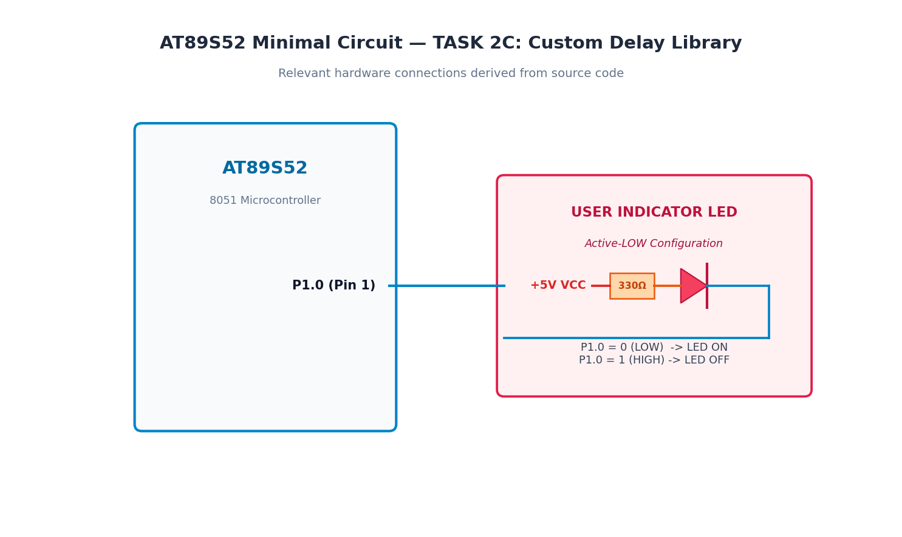

# EXPERIMENT DETAILS

**EXP:** CONTINUOUS ASSESSMENT 2

**DATE:** 20/07/2026 (Week 2)

**NAME OF EXP:** 8051 Tool Chain Setup – Development Board – AT89S52

**HARDWARE SETUP / PLATFORM:** AT89S52 development board — Keil µVision 5 (C51)

---

## TASK 3 : Custom Library Function for Delay

### 1. Circuit Diagram

| Signal | Pin | Description |
|---|---|---|
| User LED | P1.0 | On-board indicator, **active-LOW** (`0` = ON) |
| GPIO output | P1.0 (Pin 1) | LED connection, active-LOW |

### 2. Core Logic / Pseudocode / Code Base

**How it works**

The software delay library puts the timing loops in `delay.c` and declares its public interface in `delay.h`. Call `delay_ms(unsigned int ms)` for millisecond intervals and `delay_50us(unsigned char n)` for peripheral strobes in 50 µs increments.

At 11.0592 MHz, a 12-clock machine cycle takes about 1.08507 µs, so one millisecond is roughly 922 cycles. To approximate that interval, `delay.c` runs two 50-iteration inner loops per millisecond using a `volatile` counter.
$$\text{Cycles per ms} \approx 22 + (2 \times 50 \times 9) = 922\text{ cycles} \times 1.08507\ \mu\text{s} \approx 1.000\text{ ms}$$
The `volatile` counter preserves the loop iterations under Keil optimization. Application code can specify an interval in milliseconds with a call such as `delay_ms(500)`.

**Pseudocode:**

1. In `delay.h`: define `DELAY_1MS_INNER 50` and expose function prototypes `delay_ms()` and `delay_50us()`.
2. In `delay.c`:
   - Implement `delay_ms(ms)` with an outer loop running `ms` times and dual inner loops bounded by `DELAY_1MS_INNER`.
   - Implement `delay_50us(n)` for short hardware timing strobes.
3. In `main.c`:
   - Include `<reg52.h>` and `"delay.h"`.
   - Drive `USER_LED = LED_ON`, invoke `delay_ms(500)`, drive `USER_LED = LED_OFF`, and invoke `delay_ms(500)`.
   - Repeat in an infinite `while (1)` loop.

**Code Base:**

- Keil project resources include `TASK2C.uvproj` (Keil µVision project), `STARTUP.A51`, and the compiled image `Objects/TASK2C.hex`.
- `delay.h` — interface declarations for `delay_ms()` and `delay_50us()`
- `delay.c` — calibrated software delay functions
- `main.c` — 1 Hz LED blink application calling `delay_ms(BLINK_HALF_MS)`

### 3. Inference

The shared `delay.h` and `delay.c` interface gives later 8051 experiments a common way to express delays in milliseconds.
