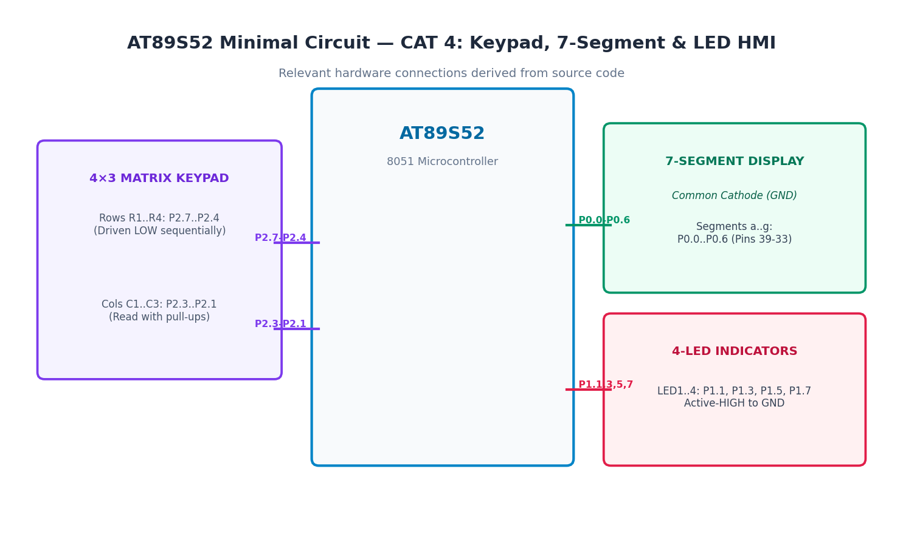

# EXPERIMENT DETAILS

**EXP:** CONTINUOUS ASSESSMENT 4

**DATE:** 03/08/2026

**NAME OF EXP:** Human-Machine Interface using Matrix Keypad, LEDs and Seven-Segment Display

**HARDWARE SETUP / PLATFORM:** AT89S52 development board (8051 architecture, 11.0592 MHz crystal) + 4×3 matrix keypad + 7-segment display + 4 LEDs — Keil µVision 5 (C51), progisp + USBasp ISP programmer

---

## TASK : Keypad-Controlled Display and LED Operations

### 1. Circuit Diagram

| Interface | Port Pins |
|---|---|
| Keypad rows R1–R4 | P2.7–P2.4 (scanned outputs) |
| Keypad columns C1–C3 | P2.3–P2.1 (sampled inputs) |
| 7-segment segments a–g | P0.0–P0.6 (common-cathode display) |
| Discrete LEDs LED1–LED4 | P1.1, P1.3, P1.5, P1.7 |

### 2. Core Logic / Pseudocode / Code Base

**How it works**

Drive one keypad row LOW with `P2 = ~(0x80 >> row)` and read the three columns. When a column goes LOW, wait 15 ms to confirm the contact and report the key once for that press. ROM tables `KEYMAP[4][3]` and `SEG_CODE[10]` store the key labels and seven-segment digit patterns.

| Key Pressed | 7-Segment Output | Triggered LED Operation |
|---|---|---|
| `1`–`4` | `1`–`4` | Turn corresponding individual LEDn ON |
| `5` | `5` | Running LED chaser |
| `6` | `6` | Alternating pattern (`1010` ↔ `0101`) |
| `7` | `7` | 4-bit binary counter (`0`–`15`) |
| `8` | `8` | Blink all LEDs simultaneously |
| `9` | `9` | Turn all LEDs OFF |
| `0` | `0` | System reset (clear LEDs and display) |

**Pseudocode:**

1. Initialise all LEDs to OFF and blank the 7-segment display.
2. Poll `keypad_scan()` every 10 ms.
3. Whenever a new key press is registered, invoke `display_digit(key)` and `led_control(key)`.
4. Every 250 ms, advance whichever continuous animation is active (`running_led()`, `alternate_led()`, `binary_counter()`, or `blink_all()`).

**Code Base:**

- Keil project resources include `TASK4A.uvproj` (Keil µVision project), `STARTUP.A51`, and the compiled image `Objects/TASK4A.hex`.
- `keypad_scan()`, `display_digit()`, `led_control()`, `running_led()`, `binary_counter()`, `alternate_led()`, `blink_all()` — modular functions matching the lab specification
- `delay.c/.h`

### 3. Inference

Scanning rows and columns lets seven GPIO pins read twelve keys. The program shows the detected key on the seven-segment display and calls the appropriate LED pattern handler.
