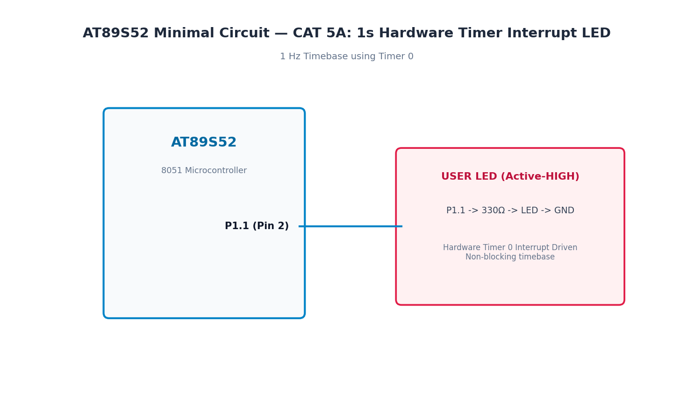

# EXPERIMENT DETAILS

**EXP:** CONTINUOUS ASSESSMENT 5

**DATE:** 10/08/2026

**NAME OF EXP:** Hardware Timer and Interrupt-Based Timing for LED Fading, Pulse Generation and Stepper Motor Control

**HARDWARE SETUP / PLATFORM:** AT89S52 development board (8051 architecture, 11.0592 MHz crystal) + LED + DSO + ULN2003 / 28BYJ-48 stepper — Keil µVision 5 (C51), progisp + USBasp ISP programmer, Digital Storage Oscilloscope

---

## TASK 1 : Timer 0 Interrupt, 1 s Software Time Base

### 1. Circuit Diagram

> **Note:** This diagram covers all CAT 5 tasks. Connect the LED or waveform load for Tasks 1 and 2, or connect ULN2003 `IN2` for Task 3. Both uses share P1.1, so connect only one load at a time.

11.0592 MHz crystal → 1.085 µs machine cycle → Timer 0 counter → overflow flag → **ISR** → software tick counter → LED toggle

| Time Base | Machine Cycles | Timer 0 Configuration |
|---|---|---|
| 1 ms | 922 | Mode 1 (16-bit), ideal `TH0:TL0 = 0xFC66` (`0xFC72` with +12-cycle ISR latency compensation), reloaded in ISR |
| 100 µs | 92 | Mode 2 (8-bit auto-reload), `TH0 = 0xA4` |

### 2. Core Logic / Pseudocode / Code Base

**How it works**

Configure Timer 0 in 16-bit Mode 1. Its 1 ms interrupt uses vector 1 and register bank 1. The ISR reloads `TH0:TL0` with `0xFC72`, adding 12 cycles to `0xFC66` for vectoring and reload overhead, then increments the tick counter. On tick 1000, it sets `second_flag`. The foreground loop clears that flag and toggles the LED.

**Pseudocode:**

1. Configure `TMOD` for Timer 0 Mode 1, preload `0xFC72`, and enable `ET0`, `EA`, and `TR0`.
2. In the Timer 0 ISR: reload `0xFC72`, increment `ms_ticks`, and set `second_flag` every 1000 ticks.
3. In `main()`: monitor `second_flag`; when set, clear the flag and invert `P1.1`.

**Code Base:**

- Keil project resources include `TASK5A.uvproj` (Keil µVision project), `STARTUP.A51`, and the compiled image `Objects/TASK5A.hex`.
- `main.c` — defines `timer0_isr() interrupt 1 using 1` and `timer0_init_1ms()`

### 3. Inference

Timer 0 keeps the one-second toggle interval in the ISR, leaving the foreground loop free to run between updates.
