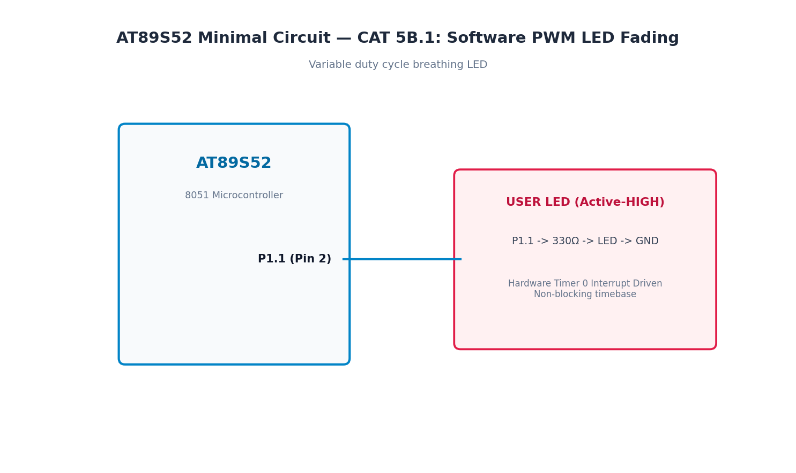

# EXPERIMENT DETAILS

**EXP:** CONTINUOUS ASSESSMENT 5

**DATE:** 10/08/2026

**NAME OF EXP:** Hardware Timer and Interrupt-Based Timing for LED Fading, Pulse Generation and Stepper Motor Control

**HARDWARE SETUP / PLATFORM:** AT89S52 development board (8051 architecture, 11.0592 MHz crystal) + LED + DSO + ULN2003 / 28BYJ-48 stepper — Keil µVision 5 (C51), progisp + USBasp ISP programmer, Digital Storage Oscilloscope

---

## TASK 2A : Software PWM LED Fading

### 1. Circuit Diagram

> **Note:** This diagram covers all CAT 5 tasks. Connect the LED or waveform load for Tasks 1 and 2, or connect ULN2003 `IN2` for Task 3. Both uses share P1.1, so connect only one load at a time.

11.0592 MHz crystal → 1.085 µs machine cycle → Timer 0 counter → overflow flag → **ISR** → software tick counter → PWM output

| Time Base | Machine Cycles | Timer 0 Configuration |
|---|---|---|
| 1 ms | 922 | Mode 1 (16-bit), ideal `TH0:TL0 = 0xFC66` (`0xFC72` with +12-cycle ISR latency compensation), reloaded in ISR |
| 100 µs | 92 | Mode 2 (8-bit auto-reload), `TH0 = 0xA4` |

### 2. Core Logic / Pseudocode / Code Base

**How it works**

In 8-bit auto-reload Mode 2, Timer 0 interrupts every 100 µs. Ten interrupts make a 1 ms PWM frame at 1 kHz. The `duty` value sets how many of those ten slots light the LED. Updating it by one slot every 100 ms (1000 interrupts) raises the brightness from 0% to 100% and back over two seconds.

**Pseudocode:**

1. Configure Timer 0 in Mode 2 with `TH0 = TL0 = 0xA4` (100 µs auto-reload).
2. Inside the ISR: increment `pwm_slot` modulo 10, drive the LED active while `pwm_slot < duty`, and raise `step_flag` every 1000 interrupts (100 ms).
3. Inside `main()`: whenever `step_flag` is set, adjust `duty` by `direction` and flip `direction` at the 0 and 10 boundaries.

**Code Base:**

- Keil project resources include `TASK5B_1.uvproj` (Keil µVision project), `STARTUP.A51`, and the compiled image `Objects/TASK5B_1.hex`.
- `main.c` — combines the 1 kHz software PWM generator and 100 ms fade ramp inside a compact Timer 0 ISR

### 3. Inference

A timer interrupt supplies the 1 kHz PWM carrier, and changing the number of active slots gives the LED a smooth fade on hardware without a dedicated PWM peripheral.
