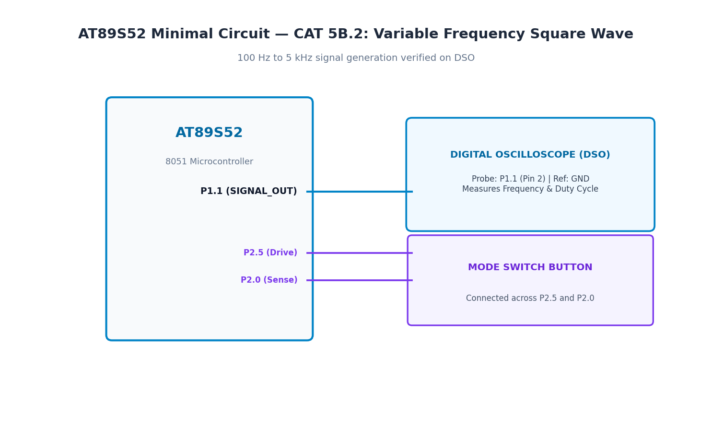

# EXPERIMENT DETAILS

**EXP:** CONTINUOUS ASSESSMENT 5

**DATE:** 10/08/2026

**NAME OF EXP:** Hardware Timer and Interrupt-Based Timing for LED Fading, Pulse Generation and Stepper Motor Control

**HARDWARE SETUP / PLATFORM:** AT89S52 development board (8051 architecture, 11.0592 MHz crystal) + LED + DSO + ULN2003 / 28BYJ-48 stepper — Keil µVision 5 (C51), progisp + USBasp ISP programmer, Digital Storage Oscilloscope

---

## TASK 2B : Variable-Frequency Square Wave

### 1. Circuit Diagram

> **Note:** This diagram covers all CAT 5 tasks. Connect the LED or waveform load for Tasks 1 and 2, or connect ULN2003 `IN2` for Task 3. Both uses share P1.1, so connect only one load at a time.

11.0592 MHz crystal → 1.085 µs machine cycle → Timer 0 counter → overflow flag → **ISR** → pin toggle

| Time Base | Machine Cycles | Timer 0 Configuration |
|---|---|---|
| 1 ms | 922 | Mode 1 (16-bit), ideal `TH0:TL0 = 0xFC66` (`0xFC72` with +12-cycle ISR latency compensation), reloaded in ISR |
| 100 µs | 92 | Mode 2 (8-bit auto-reload), `TH0 = 0xA4` |

### 2. Core Logic / Pseudocode / Code Base

**How it works**

Timer 0 toggles P1.1 at each overflow. For output frequency `f`, the 16-bit timer counts one half-period in `N = 460800 / f` machine cycles.

| Mode | Target Frequency `f` | Half-Period Counts `N` | Ideal Reload Value |
|---|---|---|---|
| 1 | 100 Hz | 4608 | `0xEE00` |
| 2 | 500 Hz | 922 | `0xFC66` |
| 3 | 1 kHz | 461 | `0xFE33` |
| 4 | 2 kHz | 230 | `0xFF1A` |
| 5 | 5 kHz | 92 | `0xFFA4` |

The firmware adjusts the theoretical values in the table by `ISR_LATENCY` (12 cycles), giving `reload = 65536 − N + 12`. On a mode change, it stops Timer 0, writes the new preload, and immediately restarts the timer. In uCsim, Mode 1 measures 100.2 Hz.

**Pseudocode:**

1. Calculate `reload = 65536 − N + ISR_LATENCY` for the selected frequency mode.
2. Inside the Timer 0 ISR: reload `TH0:TL0` and toggle output pin `P1.1`.
3. On each button press: advance to the next frequency mode and display the mode number (`1`–`5`) on the 7-segment indicator.

**Code Base:**

- Keil project resources include `TASK5B_2.uvproj` (Keil µVision project), `STARTUP.A51`, and the compiled image `Objects/TASK5B_2.hex`.
- `main.c` — defines the `HALF_PERIOD[]` look-up table and `set_mode()` reload logic

### 3. Inference

All five frequencies, from 100 Hz to 5 kHz, use the same Timer 0 ISR. A button press selects the next 16-bit preload.
