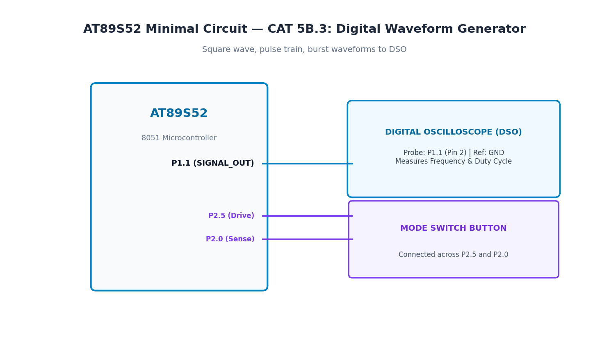

# EXPERIMENT DETAILS

**EXP:** CONTINUOUS ASSESSMENT 5

**DATE:** 10/08/2026

**NAME OF EXP:** Hardware Timer and Interrupt-Based Timing for LED Fading, Pulse Generation and Stepper Motor Control

**HARDWARE SETUP / PLATFORM:** AT89S52 development board (8051 architecture, 11.0592 MHz crystal) + LED + DSO + ULN2003 / 28BYJ-48 stepper — Keil µVision 5 (C51), progisp + USBasp ISP programmer, Digital Storage Oscilloscope

---

## TASK 2C : Different Signal Types

### 1. Circuit Diagram

> **Note:** This diagram covers all CAT 5 tasks. Connect the LED or waveform load for Tasks 1 and 2, or connect ULN2003 `IN2` for Task 3. Both uses share P1.1, so connect only one load at a time.

11.0592 MHz crystal → 1.085 µs machine cycle → Timer 0 counter → overflow flag → **ISR** → pattern bit output

| Time Base | Machine Cycles | Timer 0 Configuration |
|---|---|---|
| 1 ms | 922 | Mode 1 (16-bit), ideal `TH0:TL0 = 0xFC66` (`0xFC72` with +12-cycle ISR latency compensation), reloaded in ISR |
| 100 µs | 92 | Mode 2 (8-bit auto-reload), `TH0 = 0xA4` |

### 2. Core Logic / Pseudocode / Code Base

**How it works**

The waveform tables store strings of `'1'` and `'0'`. Timer 0 ticks every 100 µs and advances the output by one bit every five ticks (0.5 ms). The patterns are `10` for a 50% square wave, `11110000` for the duty-cycle example, `1000000000` for narrow pulses, and `1010101010` followed by ten `'0'`s for gated bursts.

**Pseudocode:**

1. Configure Timer 0 in Mode 2 for a 100 µs auto-reload period.
2. In the ISR: every 5 ticks (0.5 ms), output the next bit of the active pattern string to P1.1 and wrap at the end of the string.
3. In `main()`: poll the button and cycle through the four signal patterns on each press.

**Code Base:**

- Keil project resources include `TASK5B_3.uvproj` (Keil µVision project), `STARTUP.A51`, and the compiled image `Objects/TASK5B_3.hex`.
- `main.c` — stores the waveform table `PATTERNS[]` and implements `select_pattern()`

### 3. Inference

The same interrupt routine can output square waves, duty-cycle patterns, pulses, or bursts simply by reading a different bit table.
