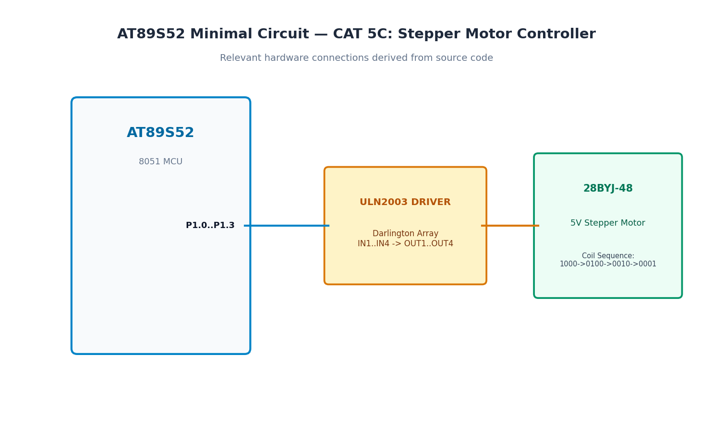

# EXPERIMENT DETAILS

**EXP:** CONTINUOUS ASSESSMENT 5

**DATE:** 10/08/2026

**NAME OF EXP:** Hardware Timer and Interrupt-Based Timing for LED Fading, Pulse Generation and Stepper Motor Control

**HARDWARE SETUP / PLATFORM:** AT89S52 development board (8051 architecture, 11.0592 MHz crystal) + LED + DSO + ULN2003 / 28BYJ-48 stepper — Keil µVision 5 (C51), progisp + USBasp ISP programmer, Digital Storage Oscilloscope

---

## TASK 3 : Stepper Motor Speed and Direction (optional)

### 1. Circuit Diagram

> **Note:** This diagram covers all CAT 5 tasks. Connect the LED or waveform load for Tasks 1 and 2, or connect ULN2003 `IN2` for Task 3. Both uses share P1.1, so connect only one load at a time.

11.0592 MHz crystal → 1.085 µs machine cycle → Timer 0 counter → overflow flag → **ISR** → coil phase step

| Time Base | Machine Cycles | Timer 0 Configuration |
|---|---|---|
| 1 ms | 922 | Mode 1 (16-bit), ideal `TH0:TL0 = 0xFC66` (`0xFC72` with +12-cycle ISR latency compensation), reloaded in ISR |
| 100 µs | 92 | Mode 2 (8-bit auto-reload), `TH0 = 0xA4` |

### 2. Core Logic / Pseudocode / Code Base

**How it works**

The Timer 0 ISR counts 1 ms ticks. When it reaches `step_ms`, it advances the wave-drive sequence (`1000` → `0100` → `0010` → `0001`) on P1.0–P1.3. Keys `1`, `2`, and `3` set 100, 50, and 10 ms per step respectively. Key `4` reverses the motor and `5` starts or stops it.

**Pseudocode:**

1. Initialise Timer 0 to generate a 1 ms periodic interrupt.
2. Inside the ISR: increment `ms_count`; once it reaches `step_ms`, step `phase` forward or backward and drive `STEP_SEQ[phase]` onto P1.0–P1.3.
3. Inside `main()`: scan the keypad and update `step_ms`, `clockwise`, or `running` accordingly.

**Code Base:**

- Keil project resources include `TASK5C.uvproj` (Keil µVision project), `STARTUP.A51`, and the compiled image `Objects/TASK5C.hex`.
- `main.c` — contains the `STEP_SEQ[]` excitation table and `keypad_get()` scanner

### 3. Inference

Timer interrupts advance the motor coils at the selected rate while the foreground loop scans the keypad.
