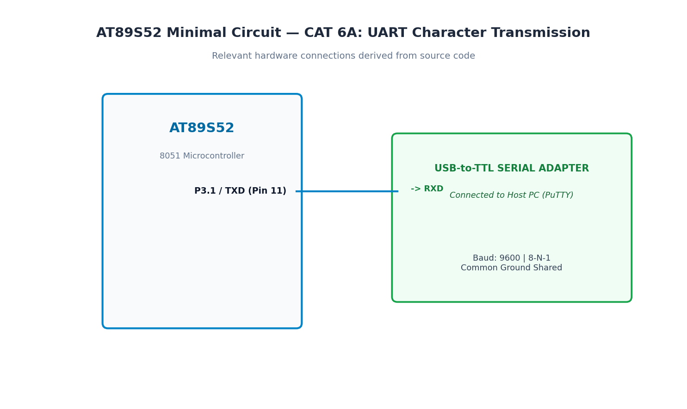

# EXPERIMENT DETAILS

**EXP:** CONTINUOUS ASSESSMENT 6

**DATE:** 17/08/2026

**NAME OF EXP:** UART Driver and Serial Debugging

**HARDWARE SETUP / PLATFORM:** AT89S52 development board (8051 architecture, 11.0592 MHz crystal) + USB-to-TTL serial adapter + PuTTY — Keil µVision 5 (C51), progisp + USBasp ISP programmer, PuTTY

---

## TASK A : UART Initialisation and Character Transmission

### 1. Circuit Diagram

| 8051 Pin | USB-to-TTL Pin |
|---|---|
| P3.1 (`TXD`) | `RX` |
| P3.0 (`RXD`) | `TX` |
| `GND` | `GND` |

Set PuTTY to **9600 baud, 8 data bits, no parity, and 1 stop bit (9600-8-N-1)**.




### 2. Core Logic / Pseudocode / Code Base

**How it works**

Set `SCON = 0x50` for 8-bit variable-baud UART operation, then configure Timer 1 in 8-bit auto-reload Mode 2, load `TH1 = 0xFD`, and start the timer. To transmit a byte, `uart_putc()` writes `SBUF`, waits until hardware sets `TI`, and clears the flag. The boot message starts with `'U'` (`0x55`), whose alternating bits provide a framing check, followed by repeated greetings.

**Pseudocode:**

1. Call `uart_init()` to set up `SCON` and Timer 1 for 9600 baud.
2. Transmit the test character `'U'` followed by `\r\n`.
3. In an infinite loop: transmit `"Hello from 8051\r\n"` and pause for 0.5 s.

**Code Base:**

- Keil project resources include `TASK6A.uvproj` (Keil µVision project), `STARTUP.A51`, and the compiled image `Objects/TASK6A.hex`.
- `main.c` — implements `uart_init()`, `uart_putc()`, and `uart_puts()`

**Expected result**

```
U
Hello from 8051
Hello from 8051
...
```

**Hardware Register Summary:**

| Aspect | Register / Formula |
|---|---|
| UART I/O pins | `TXD` on P3.1, `RXD` on P3.0 (Port 3 alternate functions) |
| Serial control | `SCON`: Mode 1 (8-bit UART, variable baud) + `REN = 1` → `SCON = 0x50` |
| Data buffer | `SBUF` (physically separate transmit and receive registers sharing one SFR address) |
| Transmit flag | `TI` is asserted by hardware at the stop bit and must be cleared in software |
| Baud clock source | Timer 1 operating in Mode 2 (8-bit auto-reload) |
| 9600 baud reload | `11059200 / (384 × (256 − TH1))` → `TH1 = 0xFD` |
| Receive flag | `RI` is asserted when a complete frame arrives in `SBUF` |

### 3. Inference

A legible greeting in PuTTY confirms the UART frame settings, the Timer 1 reload (`0xFD`), and the transmit polling sequence.
