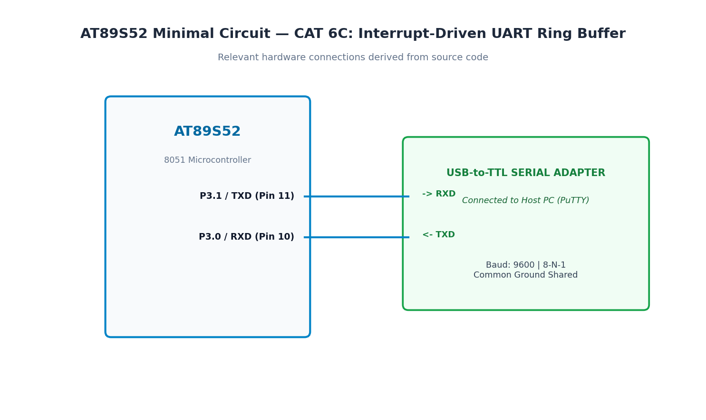

# EXPERIMENT DETAILS

**EXP:** CONTINUOUS ASSESSMENT 6

**DATE:** 17/08/2026

**NAME OF EXP:** UART Driver and Serial Debugging

**HARDWARE SETUP / PLATFORM:** AT89S52 development board (8051 architecture, 11.0592 MHz crystal) + USB-to-TTL serial adapter + PuTTY — Keil µVision 5 (C51), progisp + USBasp ISP programmer, PuTTY

---

## TASK C : Interrupt-Driven RX Ring Buffer

### 1. Circuit Diagram

| 8051 Pin | USB-to-TTL Pin |
|---|---|
| P3.1 (`TXD`) | `RX` |
| P3.0 (`RXD`) | `TX` |
| `GND` | `GND` |

Set PuTTY to **9600 baud, 8 data bits, no parity, and 1 stop bit (9600-8-N-1)**.




### 2. Core Logic / Pseudocode / Code Base

**How it works**

The serial ISR at vector 4 reads incoming bytes from `SBUF` and advances `head` in a 16-entry ring. One entry stays free to distinguish full from empty, leaving 15 usable slots. The ISR also clears `TI` on transmit completion. In the foreground, `main` advances `tail` as it assembles input up to Enter and keeps the LED heartbeat running.

**Pseudocode:**

1. Initialise the UART and enable serial and global interrupts (`ES = 1`, `EA = 1`).
2. Inside the serial ISR: if `RI` is set, push `SBUF` into the ring buffer; if `TI` is set, clear `tx_busy`.
3. In `main()`: drain available bytes from the ring buffer, echo each character, and append it to `line`.
4. When Enter (`\r` or `\n`) is received, output `Got N chars: <line>`.
5. Continuously toggle the heartbeat LED in the foreground loop.

**Code Base:**

- Keil project resources include `TASK6C.uvproj` (Keil µVision project), `STARTUP.A51`, and the compiled image `Objects/TASK6C.hex`.
- `uart.c` / `uart.h` — serial ISR, 16-byte ring buffer, `uart_available()`, and `uart_getc()`
- `main.c` — line assembly, echo, and background LED heartbeat

**Expected result**

```
> hello
Got 5 chars: hello
```

**Hardware Register Summary:**

| Aspect | Register / Formula |
|---|---|
| UART I/O pins | `TXD` on P3.1, `RXD` on P3.0 (Port 3 alternate functions) |
| Serial control | `SCON`: Mode 1 (8-bit UART, variable baud) + `REN = 1` → `SCON = 0x50` |
| Data buffer | `SBUF` (physically separate transmit and receive registers sharing one SFR address) |
| Transmit flag | `TI` is asserted by hardware at the stop bit and must be cleared in software |
| Baud clock source | Timer 1 operating in Mode 2 (8-bit auto-reload) |
| 9600 baud reload | `11059200 / (384 × (256 − TH1))` → `TH1 = 0xFD` |
| Receive flag | `RI` is asserted when a complete frame arrives in `SBUF` |

### 3. Inference

At 9600 baud, the ring holds about 15 ms of input while the foreground is busy. If another character arrives when the ring is full, the firmware discards it and exposes the count through `uart_overflows()`.
