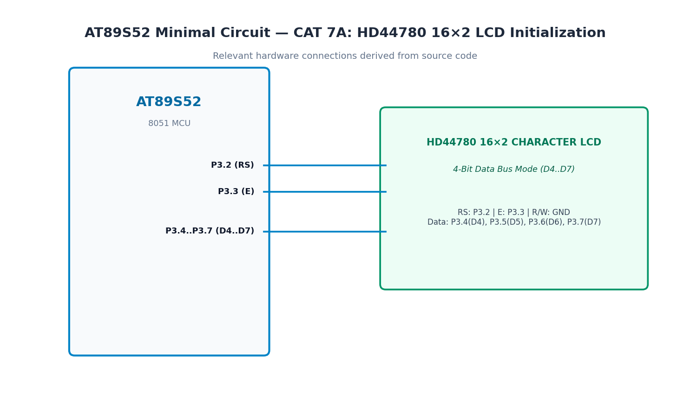

# EXPERIMENT DETAILS

**EXP:** CONTINUOUS ASSESSMENT 7

**DATE:** 24/08/2026

**NAME OF EXP:** 16×2 LCD Driver Development and Dynamic Display Control

**HARDWARE SETUP / PLATFORM:** AT89S52 development board (8051 architecture, 11.0592 MHz crystal) + HD44780 16×2 character LCD + 4×4 matrix keypad — Keil µVision 5 (C51), progisp + USBasp ISP programmer, HD44780 datasheet

---

## TASK 7A : LCD Initialisation and Character / String Display

### 1. Circuit Diagram

| LCD Signal | 8051 Pin | Function |
|---|---|---|
| `RS` | P3.2 | Register select (`0` = instruction, `1` = data) |
| `E` | P3.3 | Enable strobe (latches nibble on falling edge) |
| `D4`–`D7` | P3.4–P3.7 | 4-bit parallel data bus |
| `RW` | `GND` | Tied low for write-only operation |
| `V0` | 10 kΩ potentiometer | Display contrast adjustment |

Wire the keypad rows to P2.7–P2.4 and the columns to P2.3–P2.0.




### 2. Core Logic / Pseudocode / Code Base

**How it works**

Wait more than 15 ms after VCC rises, then have `lcd_init()` strobe `0x3` three times and `0x2` once to enter 4-bit mode. Send each subsequent byte as its high nibble followed by its low nibble. Use `0x28` for two lines with a 5×8 font, `0x0C` to turn on the display with the cursor hidden, `0x06` to advance the cursor after a write, and `0x01` to clear the display. Allow 2 ms for Clear Display and Return Home and 50 µs for ordinary commands or character writes.

**Pseudocode:**

1. Execute `lcd_init()` to configure the HD44780 controller in 4-bit mode.
2. Set DDRAM address `0x80` via `lcd_cmd(0x80)` and write `'A'` using `lcd_data('A')`.
3. Position the cursor at row 0, column 2 with `lcd_goto(0, 2)` and print `"CAT7 LCD TEST"`.
4. Position the cursor at row 1, column 0 with `lcd_goto(1, 0)` and print `"8051 4-BIT MODE"`.

**Code Base:**

- Keil project resources include `TASK7A.uvproj` (Keil µVision project), `STARTUP.A51`, and the compiled image `Objects/TASK7A.hex`.
- `lcd.h` — HD44780 instruction opcodes and driver prototypes
- `lcd.c` — nibble strobe helper, `lcd_init()`, `lcd_cmd()`, and `lcd_data()`
- `main.c`

**Expected result**

```
A CAT7 LCD TEST
8051 4-BIT MODE
```

### 3. Inference

The HD44780 initialization sequence and 4-bit instruction interface let six GPIO pins drive both rows of the 16×2 LCD.
