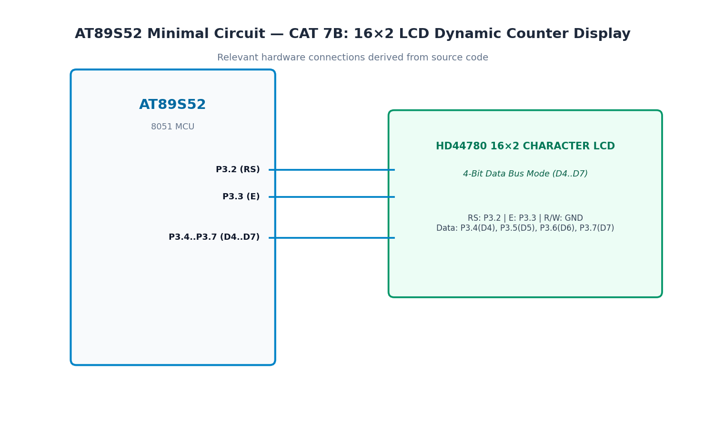

# EXPERIMENT DETAILS

**EXP:** CONTINUOUS ASSESSMENT 7

**DATE:** 24/08/2026

**NAME OF EXP:** 16×2 LCD Driver Development and Dynamic Display Control

**HARDWARE SETUP / PLATFORM:** AT89S52 development board (8051 architecture, 11.0592 MHz crystal) + HD44780 16×2 character LCD + 4×4 matrix keypad — Keil µVision 5 (C51), progisp + USBasp ISP programmer, HD44780 datasheet

---

## TASK 7B : Cursor Positioning and Dynamic Value Update

### 1. Circuit Diagram

| LCD Signal | 8051 Pin | Function |
|---|---|---|
| `RS` | P3.2 | Register select (`0` = instruction, `1` = data) |
| `E` | P3.3 | Enable strobe (latches nibble on falling edge) |
| `D4`–`D7` | P3.4–P3.7 | 4-bit parallel data bus |
| `RW` | `GND` | Tied low for write-only operation |
| `V0` | 10 kΩ potentiometer | Display contrast adjustment |

Wire the keypad rows to P2.7–P2.4 and the columns to P2.3–P2.0.




### 2. Core Logic / Pseudocode / Code Base

**How it works**

To position the cursor, `lcd_goto(row, col)` sends the DDRAM command `0x80 + (row ? 0x40 : 0x00) + col`. `lcd_print_number()` collects digits with `value % 10 + '0'` and writes them in reverse extraction order, starting with the most significant digit. The labels are printed at startup. At runtime, the firmware clears and rewrites only the numeric fields on the 500 ms update cycle.

**Pseudocode:**

1. Initialise the LCD and print the static labels `"Counter:"` and `"Up time:"` once.
2. Every 500 ms, clear the counter field and write the updated count at its DDRAM offset.
3. Every 1000 ms (2 ticks), clear and update the elapsed seconds field on the second row.

**Code Base:**

- Keil project resources include `TASK7B.uvproj` (Keil µVision project), `STARTUP.A51`, and the compiled image `Objects/TASK7B.hex`.
- `lcd_goto()`, `lcd_puts()`, `lcd_print_number()`, and `lcd_clear_field()`

**Expected result**

```
Counter:  137
Up time: 68   s
```

### 3. Inference

Addressing DDRAM directly lets the firmware overwrite the changing numbers in place while keeping the static labels visible.
