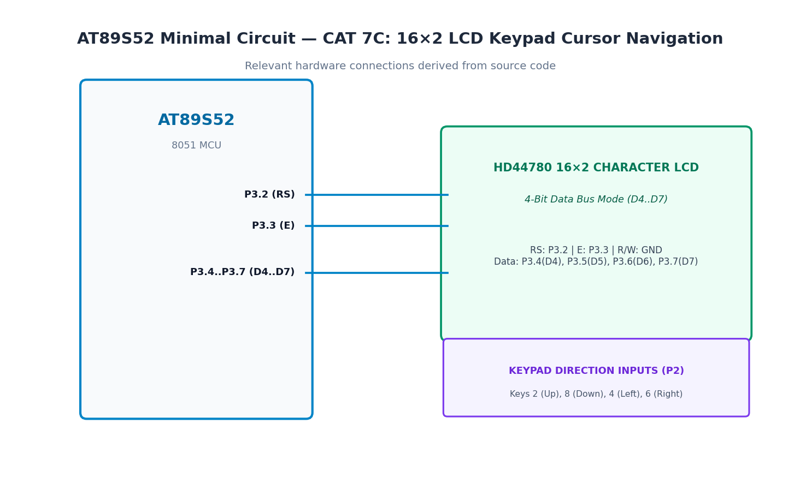

# EXPERIMENT DETAILS

**EXP:** CONTINUOUS ASSESSMENT 7

**DATE:** 24/08/2026

**NAME OF EXP:** 16×2 LCD Driver Development and Dynamic Display Control

**HARDWARE SETUP / PLATFORM:** AT89S52 development board (8051 architecture, 11.0592 MHz crystal) + HD44780 16×2 character LCD + 4×4 matrix keypad — Keil µVision 5 (C51), progisp + USBasp ISP programmer, HD44780 datasheet

---

## TASK 7C : 4×4 Keypad Character Movement

### 1. Circuit Diagram

| LCD Signal | 8051 Pin | Function |
|---|---|---|
| `RS` | P3.2 | Register select (`0` = instruction, `1` = data) |
| `E` | P3.3 | Enable strobe (latches nibble on falling edge) |
| `D4`–`D7` | P3.4–P3.7 | 4-bit parallel data bus |
| `RW` | `GND` | Tied low for write-only operation |
| `V0` | 10 kΩ potentiometer | Display contrast adjustment |

Wire the keypad rows to P2.7–P2.4 and the columns to P2.3–P2.0.

### 2. Core Logic / Pseudocode / Code Base

**How it works**

Start the asterisk (`'*'`) at `(0, 0)`. Keys `2`, `8`, `4`, and `6` move it up, down, left, and right within rows `0`–`1` and columns `0`–`15`. Key `5` returns it to the origin. For each accepted press, erase the old marker with a space `' '`, draw it at the new position, and wait for release before allowing another step.

**Pseudocode:**

1. Initialise the LCD and render `'*'` at `(0, 0)`.
2. Scan the 4×4 keypad; if no key is pressed, continue polling.
3. Overwrite the current `(row, col)` cell with `' '`.
4. Compute the new `(row, col)` coordinates clamped to `[0..1]` and `[0..15]`.
5. Draw `'*'` at the new location and wait until the key is released.

**Code Base:**

- Keil project resources include `TASK7C.uvproj` (Keil µVision project), `STARTUP.A51`, and the compiled image `Objects/TASK7C.hex`.
- `keypad_scan()` — 4×4 row-column scanner backed by `KEYMAP[4][4]`
- 4-bit HD44780 LCD driver from Task 7A

### 3. Inference

The keypad supplies the movement commands, and direct DDRAM writes update just the affected cells on the 16×2 display.
