# 25011102099_FIoT_LAB — 8051 & STM32 Embedded Systems and IoT Laboratory


This repository contains the lab work for **25CS2741 Fundamentals of Internet of Things + Lab**, part of Semester 3 of the B.Tech CSE (IoT) program at Shiv Nadar University Chennai.

- **Student Name:** Subithrasri Karthikeyan
- **Register Number:** 25011102099

The exercises begin with register-level C on the **8051** and move to **STM32** projects configured with STM32CubeMX and built with HAL. The final projects use I²C to read a **BME280** environmental sensor and an **ESP8266** to send the readings over Wi-Fi. They first expose telemetry through **HTTP/JSON**, then use **MQTT** publishing and subscriptions with **Node-RED** dashboards.


## 8051 (AT89S52) — Keil µVision, Bare-Metal Embedded C

| CAT | Experiment Topic | Key Concepts | Directory |
|---|---|---|---|
| 2 | Toolchain setup, bare-metal LED blink, custom delay library | `sbit` SFR bit addressing, calibrated busy-wait loops, `delay_ms()` | [TASK2B](8051/CAT2/TASK2B/), [TASK2C](8051/CAT2/TASK2C/) |
| 3 | Push-button driven four-state LED pattern controller | finite state machine, contact debouncing, rising-edge detection | [TASK3A](8051/CAT3/TASK3A/) |
| 4 | Matrix keypad, 7-segment display, and multi-LED HMI | row-column scanning, ROM look-up tables, modular function design | [TASK4A](8051/CAT4/TASK4A/) |
| 5 | Hardware timer interrupts: 1 s tick, PWM fading, square waves, digital waveforms, stepper drive | Timer 0 Modes 1 & 2, interrupt-driven time base, software PWM | [TASK5A](8051/CAT5/TASK5A/), [TASK5B.1](8051/CAT5/TASK5B/TASK5B.1/), [TASK5B.2](8051/CAT5/TASK5B/TASK5B.2/), [TASK5B.3](8051/CAT5/TASK5B/TASK5B.3/), [TASK5C](8051/CAT5/TASK5C/) |
| 6 | Serial UART driver, character echo, interrupt RX ring buffer | `SCON`, Timer 1 baud rate generation, `TI`/`RI` flags, serial ISR | [TASK6A](8051/CAT6/TASK6A/), [TASK6B](8051/CAT6/TASK6B/), [TASK6C](8051/CAT6/TASK6C/) |
| 7 | HD44780 16×2 LCD driver, live counter updates, keypad cursor navigation | 4-bit LCD initialisation sequence, DDRAM cursor addressing | [TASK7A](8051/CAT7/TASK7A/), [TASK7B](8051/CAT7/TASK7B/), [TASK7C](8051/CAT7/TASK7C/) |

## STM32 — STM32CubeMX + STM32CubeIDE, HAL Drivers

| CAT | Experiment Topic | Target Board | Key Concepts | Directory |
|---|---|---|---|---|
| 8 | GPIO bring-up, software debounce, short vs. long press detection | Blue Pill F103C6 | internal pull-ups, non-blocking `HAL_GetTick()` timestamps | [TASK8A](STM32/CAT8/TASK8A/), [TASK8B](STM32/CAT8/TASK8B/), [TASK8C](STM32/CAT8/TASK8C/) |
| 9 | UART serial echo and string command parser | Blue Pill F103C6 | USART2 polling, command normalisation, CR/LF line endings | [TASK9A](STM32/CAT9/TASK9A/), [TASK9B](STM32/CAT9/TASK9B/) |
| 10 | ESP8266 AT command interface, Wi-Fi station connection (Tasks 9A–9C), HTTP web server (Tasks 10C/10d) | Blue Pill F103C8 + Wemos | dual UART bridging, AT command framing, `+IPD`, `CIPSEND` | [TASK10A](STM32/CAT10/TASK10A/), [TASK10B](STM32/CAT10/TASK10B/), [TASK10C](STM32/CAT10/TASK10C/), [TASK10D](STM32/CAT10/TASK10D/) |
| 11 | Cortex-M4 GPIO output, system clock verification, multi-tier button press classification | NUCLEO-F401RE | HSE bypass clock input, 84 MHz PLL configuration | [TASK11A](STM32/CAT11/TASK11A/), [TASK11B](STM32/CAT11/TASK11B/), [TASK11C](STM32/CAT11/TASK11C/) |
| 12 | BME280 I²C sensor integration, HTTP JSON endpoint, Node-RED statistical analysis | NUCLEO-F401RE | I²C register access, Bosch compensation API, JSON formatting, `Content-Length` | [TASK12A](STM32/CAT12/TASK12A/), [TASK12B](STM32/CAT12/TASK12B/) |
| 13 | BME280 telemetry over MQTT and live Node-RED dashboard | NUCLEO-F401RE | MQTT `CONNECT` / `PUBLISH` / `SUBSCRIBE` packet handling | [TASK13A](STM32/CAT13/TASK13A/), [TASK13B](STM32/CAT13/TASK13B/), [TASK13C](STM32/CAT13/TASK13C/) |

## Circuit Diagrams


### CAT 2 — LED Blink and Delay Library

[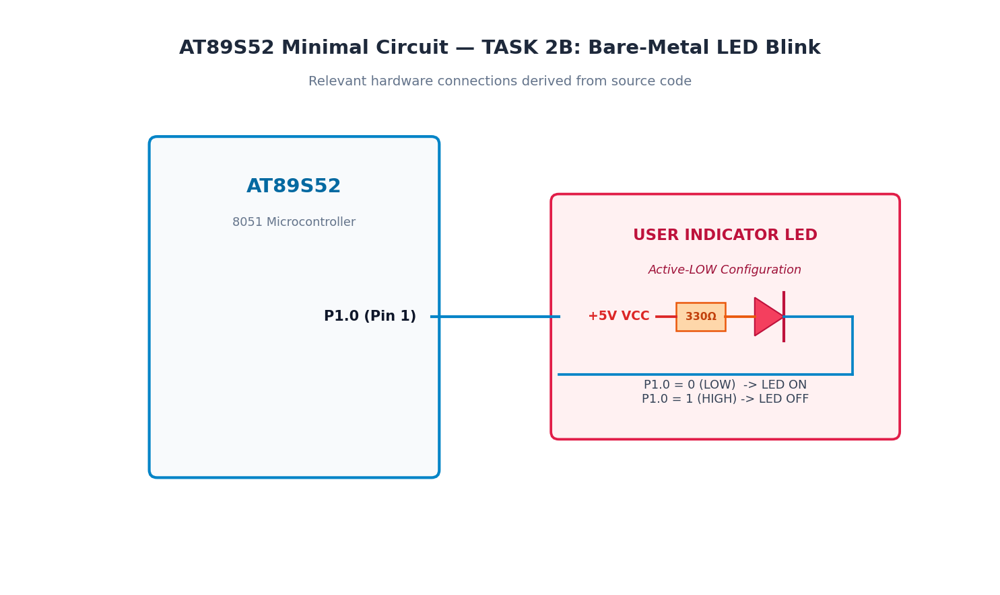](8051/CAT2/)

### CAT 3 — Button LED Pattern Generator

[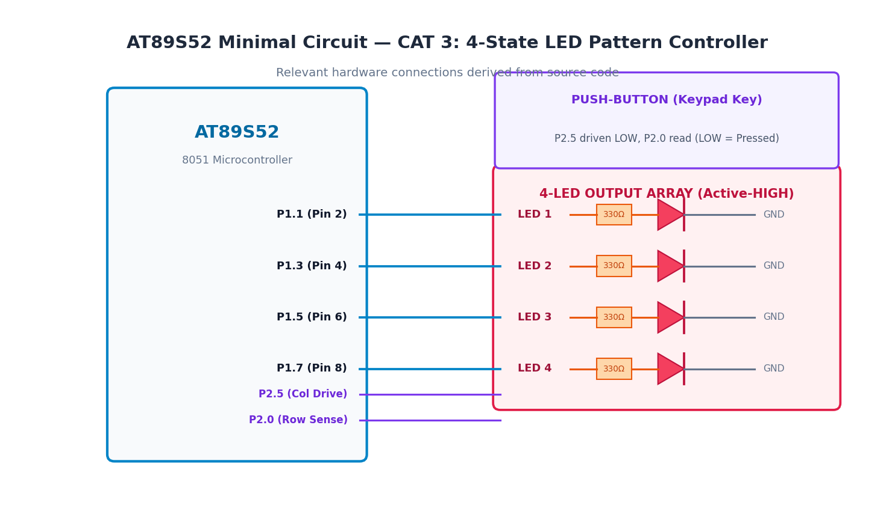](8051/CAT3/)

### CAT 4 — Keypad 7Segment HMI

[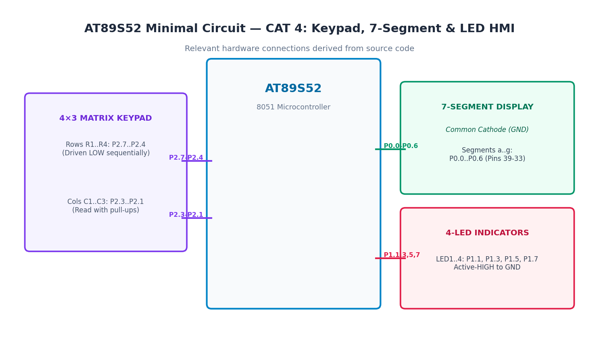](8051/CAT4/)

### CAT 5 — Timer Interrupts PWM Stepper

[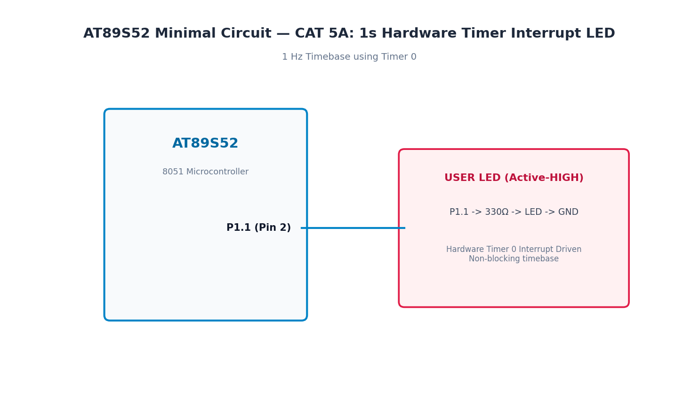](8051/CAT5/)

### CAT 6 — UART Driver Serial Debugging

[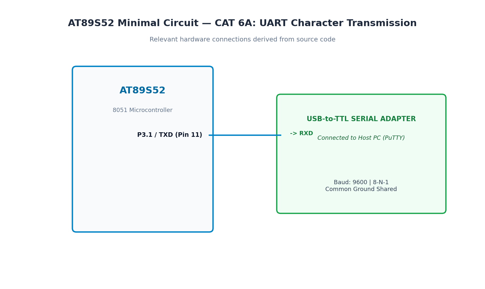](8051/CAT6/)

### CAT 7 — LCD 16x2 Driver

[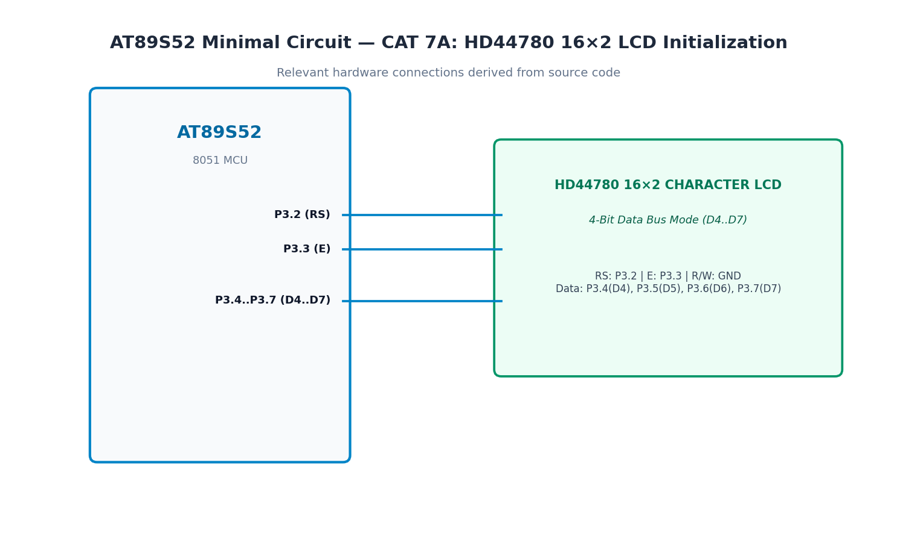](8051/CAT7/)

### CAT 8 — GPIO Button LED

[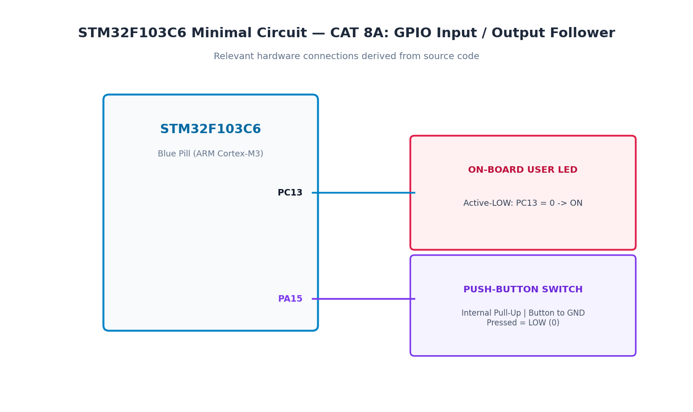](STM32/CAT8/)

### CAT 9 — UART Command LED

[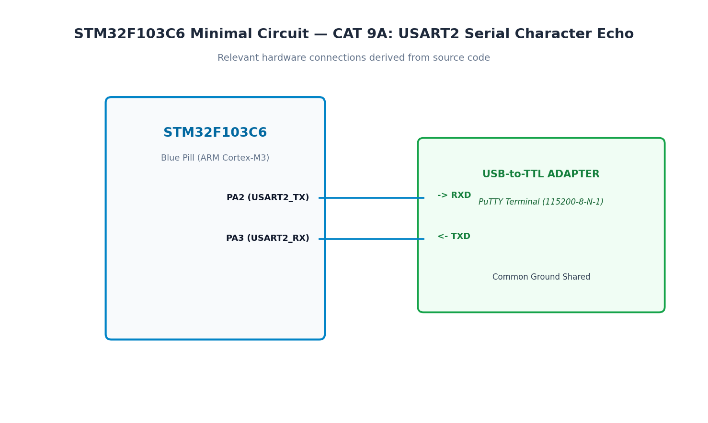](STM32/CAT9/)

### CAT 10 — Wemos WiFi AT Commands

[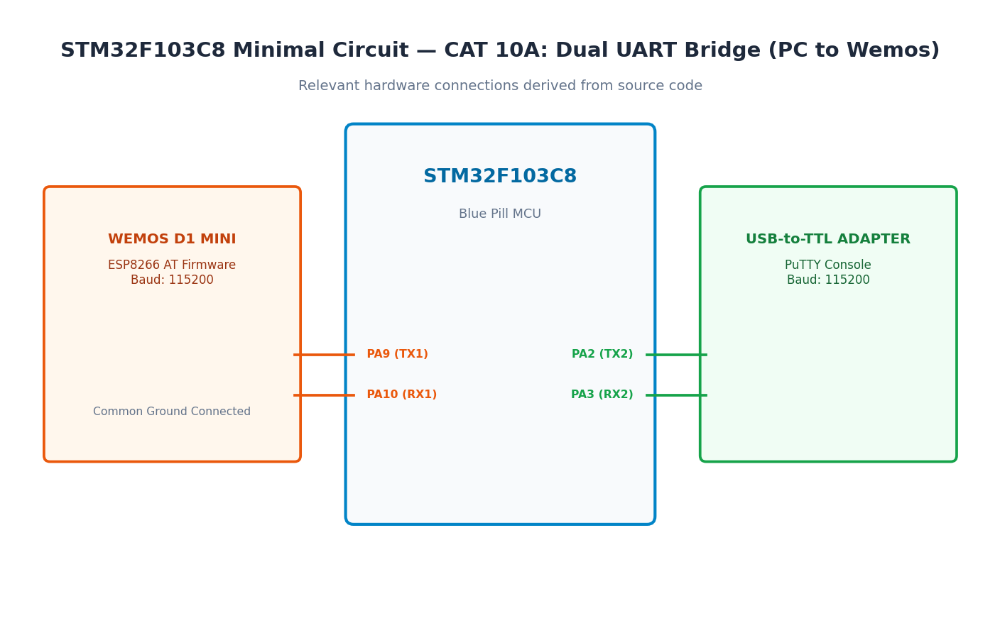](STM32/CAT10/)

### CAT 11 — GPIO User Input

[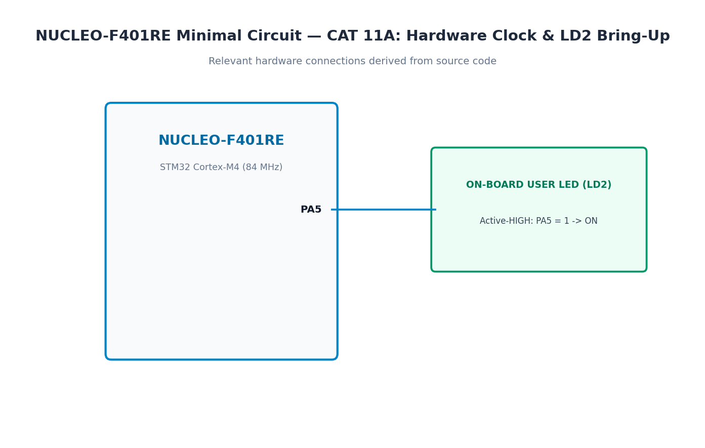](STM32/CAT11/)

### CAT 12 — BME280 I2C HTTP NodeRED

[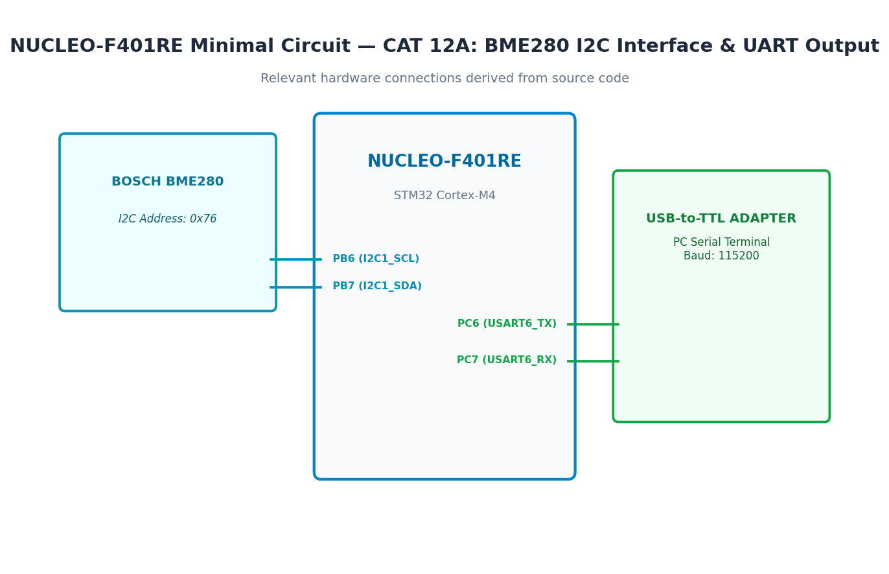](STM32/CAT12/)

### CAT 13 — BME280 MQTT NodeRED

[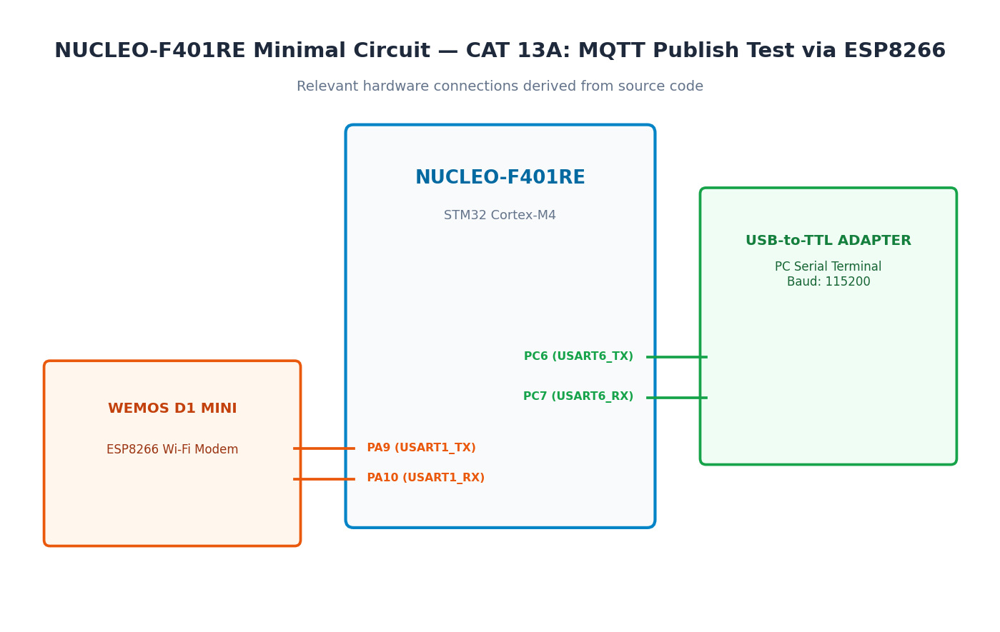](STM32/CAT13/)

## System Architecture (Final Assessments)

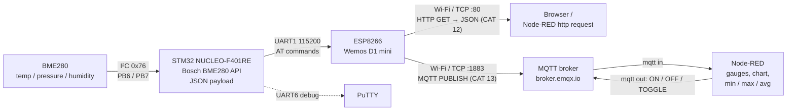

## Technical Competencies Demonstrated

| Competency | Assessments |
|---|---|
| Direct register-level programming (SFRs, `sbit`, zero external libraries) | CAT 2 – 4 |
| Hardware timer configuration, ISRs, and software-generated PWM | CAT 5, 6 |
| Custom peripheral drivers built from datasheet specifications (UART, HD44780 LCD) | CAT 6, 7 |
| Non-blocking switch debouncing and finite state machines | CAT 3, 8, 11 |
| STM32CubeMX peripheral setup, PLL clock tree tuning, and HAL APIs | CAT 8 – 13 |
| Serial framing, circular ring buffers, and interrupt-driven UART reception | CAT 6C, 10D, 12B |
| I²C sensor interfacing using an official vendor driver API | CAT 12, 13 |
| ESP8266 AT modem control, multi-link TCP server, and raw HTTP responses | CAT 10, 12 |
| MQTT 3.1.1 packet construction and parsing (`CONNECT`, `PUBLISH`, `SUBSCRIBE`) | CAT 13 |
| Node-RED data pipelines, live UI dashboards, and rolling statistics | CAT 12, 13 |
| Automated command-line builds and verification | `tools/build_all.sh`, `tools/check_lib_copies.sh` |

## Verification Summary

| Component | Verification Method | Outcome |
|---|---|---|
| All 17 STM32 targets | Compiled and linked via `arm-none-eabi-gcc` (`tools/build_all.sh`) | 0 errors and 0 warnings with `-Wall -Wextra` enabled on application sources (`Core/`). Vendor HAL files compile with `-w` to suppress upstream warnings — see [`docs/build-log.txt`](docs/build-log.txt) |
| All 15 8051 targets | Built using SDCC from the Keil C51 sources (converting compiler-specific keywords on a temporary copy) | 0 errors; tracked HEX binaries match the source tree. Note that SDCC differs from Keil C51, so exact Keil binary output is not checked here |
| MQTT client stack (CAT 13) | Host-side test suite (`make -C tests` with ASan + UBSan) | 54 packet tests + 56 ESPLib tests + 26 AT-driver tests run against a mocked ESP8266 and broker with fault injection (UART re-arm failures, corrupted `+IPD` frames, ring buffer overflows), alongside a sync check verifying that project-local library copies match `Common_Libraries/`: covers both `CIPSEND` prompt sequences, `PINGRESP` timeouts, `UNSUBACK`, QoS-0 enforcement, malformed/non-canonical packets, fragmented and coalesced TCP segments, mismatched packet IDs, mid-packet RX overflow with full TCP/MQTT recovery, `CONNACK` Session Present validation, wildcard rejection, `NULL` pointer guards, oversized AT lines, and link drops during `CIPSEND` |
| 8051 timing accuracy | Profiled in the uCsim 8051 instruction simulator at 11.0592 MHz (SDCC binaries) | CAT 2 blink period = 1.000 s, `delay_ms()` = 1.000 ms, CAT 5 timer toggle = 0.999 s, 100 Hz square-wave mode = 100.2 Hz |
| Node-RED flows | Validated JSON schema, node wiring, and JavaScript function syntax | All valid |
| Flash footprint | Inspected via linker size reports | Largest Blue Pill firmware uses 7.9 KB of 32 KB flash; largest Nucleo firmware uses 33 KB of 512 KB flash |
| Physical hardware testing | Verified live during laboratory evaluation sessions (CAT 2 – 13) | Hardware runs are not recorded in git; automated checks validate compilation, protocol logic, and cycle timing. Follow the hardware verification table below to replicate results on the boards |

### Hardware Verification Checklist

| CAT | Target Hardware | Expected Behaviour on the Bench |
|---|---|---|
| 2 | AT89S52 | On-board P1.0 LED flashes at ~1 Hz (500 ms ON, 500 ms OFF) |
| 3 | AT89S52 | Each button press advances the 4 LEDs through Running → Binary → Alternate → Flash modes |
| 4 | AT89S52 | Pressing a keypad button shows its digit on the 7-segment display and triggers the assigned LED action |
| 5 | AT89S52 | LED toggles every 1 s; smooth PWM breathing; 100 Hz – 5 kHz square wave on P1.1 (verified on DSO); keypad controls stepper speed and direction |
| 6 | AT89S52 | PuTTY (9600-8-N-1) displays `Hello from 8051` and echoes back characters typed by the user |
| 7 | AT89S52 | Static text appears on both LCD lines; live counter updates in place; keys 2/4/6/8 move the `*` cursor across the screen |
| 8 | Blue Pill | PC13 LED mirrors or toggles with button PA15; holding for ≥ 1 s triggers continuous blinking upon release |
| 9 | Blue Pill | PuTTY (115200): echoes characters and executes `LED ON`, `LED OFF`, and `LED TOGGLE` on PC13 |
| 10 | Blue Pill + Wemos | Terminal logs `>> AT` / `<< OK`, prints assigned IP and MAC after joining Wi-Fi, and serves the STM32 web page at `http://<IP>/` |
| 11 | Nucleo-F401RE | LD2 blinks at 1 Hz (confirming the 84 MHz system clock); B1 distinguishes short, long, and very long presses |
| 12 | Nucleo + BME280 + Wemos | Debug UART reports chip ID `0x60` and compensated T / P / H values; browsers and Node-RED receive the JSON payload |
| 13 | Nucleo + BME280 + Wemos | Debug UART logs `CONNACK accepted`; MQTT subscribers and Node-RED receive JSON telemetry on `subithrasri/stm32/bme280`; CAT13B switches LD2 in response to `ON` / `OFF` / `TOGGLE` |

## Hardware Inventory

| Component | Assessments | Specifications & Notes |
|---|---|---|
| AT89S52 development board | CAT 2–7 | 11.0592 MHz crystal, active-low user LED on P1.0, matrix keypad, 7-segment display, 16×2 LCD header, USBasp ISP interface |
| STM32 Blue Pill (F103C6 / F103C8) | CAT 8–10 | 8 MHz crystal multiplied to 72 MHz via PLL, active-low LED on PC13, programmed via ST-LINK V2 (SWD) |
| NUCLEO-F401RE | CAT 11–13 | 8 MHz ST-LINK MCO clock input (HSE bypass) scaled to 84 MHz, active-high LD2 on PA5, active-low B1 button on PC13 |
| Wemos D1 mini (ESP8266) | CAT 10, 12, 13 | Runs Espressif AT command firmware at 115200 baud |
| Bosch BME280 breakout | CAT 12, 13 | Temperature, humidity, and pressure sensor on I²C address `0x76` |
| USB-to-TTL serial adapter | CAT 6, 9, 10, 12, 13 | Connects MCU UART pins to a PC running PuTTY |
| ULN2003 driver + 28BYJ-48 | CAT 5 (optional task) | Unipolar stepper motor and Darlington array driver |

## Software & Toolchain

| Tool / Library | Role |
|---|---|
| Keil µVision 5 (C51) | IDE and compiler for 8051 projects (`.uvproj`) |
| progisp + USBasp | ISP flashing utility for the AT89S52 |
| STM32CubeIDE / STM32CubeMX | Pinout/clock configuration and IDE for STM32 projects (`.ioc`, `.project`, `.cproject`) |
| Bosch BME280 Sensor API v3.5.1 | Official compensation driver for BME280 (CAT 12, 13) |
| ESPLib API (clean-room rewrite, MIT) | ESP8266 AT + MQTT 3.1.1 client library (CAT 13) |
| PuTTY, Node-RED | Serial terminal monitor, IoT flow automation, and UI dashboarding |

## Repository Structure

The layout follows the course template. Each microcontroller family has assessment folders (`CATn`), which contain the individual projects (`TASKnX`).

```
8051/CATn/TASKnX/            self-contained Keil µVision project per task
├── *.uvproj, STARTUP.A51    Keil project file and startup assembly
├── *.c / *.h                C source and header files
└── Objects/*.hex            pre-built Intel HEX firmware image
STM32/CATn/TASKnX/           self-contained STM32CubeMX project per task
├── README.md, circuit.png
├── *.ioc, .mxproject        CubeMX hardware configuration
├── Core/, Drivers/          application sources and STM32Cube HAL drivers
├── MDK-ARM/*.uvprojx        Keil MDK-ARM project and startup assembly
└── .project, .cproject      STM32CubeIDE project descriptors
Common_Libraries/            canonical copies of shared drivers (BME280 API, ESP8266 AT driver, ESPLib MQTT, utility headers)
tools/, tests/, docs/        CI build script, library sync checker, host unit tests, build log output
```

CAT 5 Task 2 has three projects under `8051/CAT5/TASK5B`, from `TASK5B.1` through `TASK5B.3`. The CAT 10 handout names its exercises 9A–9C and 10C/10d. The corresponding project folders run from `TASK10A` through `TASK10D`.

## Building and Flashing

To flash an 8051, load the supplied `Objects/*.hex` in progisp. To rebuild, open the `.uvproj` in Keil µVision and select **Build (F7)**. The included HEX files were generated with SDCC 4.6, and their timing was checked in uCsim. See `8051/README.md`.

In Keil MDK, open the task's `MDK-ARM/*.uvprojx`. Select **Build (F7)** to compile and **Download (F8)** to flash through ST-LINK.

In STM32CubeIDE, select **File → Import → General → Existing Projects into Workspace** and point it to the task folder. Click **Build**, then select **Run → Debug As → STM32 C/C++ Application**. Wi-Fi tasks (CAT 10C, 10D, 12B, and 13) read their network settings from `Core/Inc/wifi_secrets.h`, which Git ignores. Create that header alongside `wifi_config.h` and set `#define WIFI_SSID "..."` and `#define WIFI_PASSWORD "..."`. The build uses placeholder strings when the header is absent.

In Node-RED, select **Import** from the top-right menu, choose the `NodeRED_*.json` flow, and click **Deploy**.

## Implementation Notes

* Put application changes inside CubeMX `USER CODE` sections so they survive regeneration from the `.ioc` files.
* `fmt_fixed.h` uses integer arithmetic to format sensor readings and saves the roughly 8 KB that `%f` support would add to `newlib-nano`.
* `tools/build_all.sh` builds the 32 projects from the command line. `docs/build-log.txt` records a macOS run using the STM32CubeIDE ARM toolchain and SDCC 4.6. Run `UPDATE_HEX=1 tools/build_all.sh 8051` to regenerate the tracked 8051 HEX files.
* Run `make -C tests` on the host to check the MQTT codec, ESPLib state machine, and ESP8266 AT driver with a simulated modem.
* For steps to synchronize library copies, regenerate HEX files, and refresh the build log, see [`CONTRIBUTING.md`](CONTRIBUTING.md).

## Licence

The MIT Licence covers the original code and documentation. Vendor drivers and other external components retain their own licences. See [`LICENSE`](LICENSE) and [`THIRD_PARTY_NOTICES.md`](THIRD_PARTY_NOTICES.md).

## Third-Party Components

External components include STMicroelectronics STM32Cube HAL and CMSIS headers, Bosch Sensortec `BME280_SensorAPI` (BSD-3-Clause), and Keil `STARTUP.A51`. The CAT 13 MQTT client independently implements the public function signatures of the course ESPLib, originally by Can Güveren, to match the lab handout. See [`THIRD_PARTY_NOTICES.md`](THIRD_PARTY_NOTICES.md).
