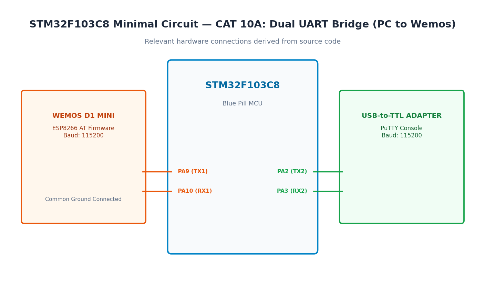
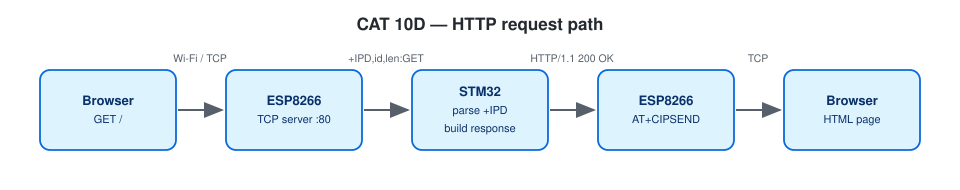

# EXPERIMENT DETAILS

**EXP:** CONTINUOUS ASSESSMENT 10

**DATE:** 05/10/2026 (Tasks 10C/10d: 12/10/2026)

**NAME OF EXP:** STM32–Wemos Wi-Fi Modem Interface Using AT Commands + HTTP Server

**HARDWARE SETUP / PLATFORM:** Blue Pill STM32F103C8T6 (ARM Cortex-M3, 72 MHz) + Wemos D1 mini (ESP8266 AT firmware) + USB-to-TTL serial adapter — STM32CubeMX + Keil MDK-ARM (STM32CubeIDE project included), STM32 HAL, PuTTY

---

## TASK 9A : Establish STM32 ↔ Wemos UART Communication

> The CAT 10 handout calls this exercise **Task 9A**. Its project is under `TASK10A`.

### 1. Circuit Diagram

| STM32 Pin | Target Connection | Role |
|---|---|---|
| `PA9` (`USART1_TX`) | Wemos `RX` | Transmit AT commands to ESP8266 |
| `PA10` (`USART1_RX`) | Wemos `TX` | Receive AT responses from ESP8266 |
| `PA2` (`USART2_TX`) / `PA3` (`USART2_RX`) | USB-to-TTL `RX` / `TX` | Debug console to PC (PuTTY) |
| `GND` | Shared ground rail | Common reference |

Set `USART1` and `USART2` to **115200-8-N-1**. The firmware reads the Wi-Fi settings from `Core/Inc/wifi_secrets.h`, which Git ignores. See `wifi_config.h` for the macro definitions.






### 2. Core Logic / Pseudocode / Code Base

**How it works**

Allow the ESP8266 two seconds to start, then send `AT` on `USART1`. Collect the reply up to `OK`, `ERROR`, `FAIL`, or a timeout and print it on `USART2`. After the initial check, the firmware bridges the two UARTs so PuTTY can send AT commands to the modem directly.

**Pseudocode:**

1. Print the startup banner on `USART2`.
2. Call `esp_startup()`: wait for modem boot, retry `AT` up to 3 times, and disable echo (`ATE0`).
3. Run `at_show("AT")` to log `>> AT` and `<< OK` on the PC console.
4. Call `at_bridge_start()`: arm interrupt-driven reception on both UARTs into dedicated 256-byte ring buffers (255 usable bytes), automatically retrying in the main loop if `HAL_UART_Receive_IT` ever reports busy.
5. Use interrupt-driven transmission (`HAL_UART_Transmit_IT`) backed by 512-byte TX ring buffers (511 usable bytes) in both directions so forwarding never blocks; track TX ring saturation separately from RX overflows.
6. In the main loop, call `at_bridge_poll()` to batch-forward buffered bytes (converting PuTTY `\r` into `\r\n` for the modem) and report any dropped bytes or TX errors.

**Code Base:**

- Keil project resources include `CAT10A_STM32_Wemos_UART_Link.ioc` (STM32CubeMX configuration), `MDK-ARM/CAT10A_STM32_Wemos_UART_Link.uvprojx` (Keil MDK), `.project` / `.cproject` (STM32CubeIDE); firmware entry point in `Core/Src/main.c`.
- `esp_read_line()` — timeout-protected line reader
- `at_command()` — collects response lines until a terminal status token
- `at_show()` — formats and logs sent commands and received responses

**Expected result**

```
STM32-WiFi MODEM TEST  (CAT10A)
ESP8266 answered, echo off
>> AT
<< OK
```

### 3. Inference

An `OK` reply from the Wemos validates the `USART1` connection and baud rate. `USART2` provides a separate link to the PC terminal.
