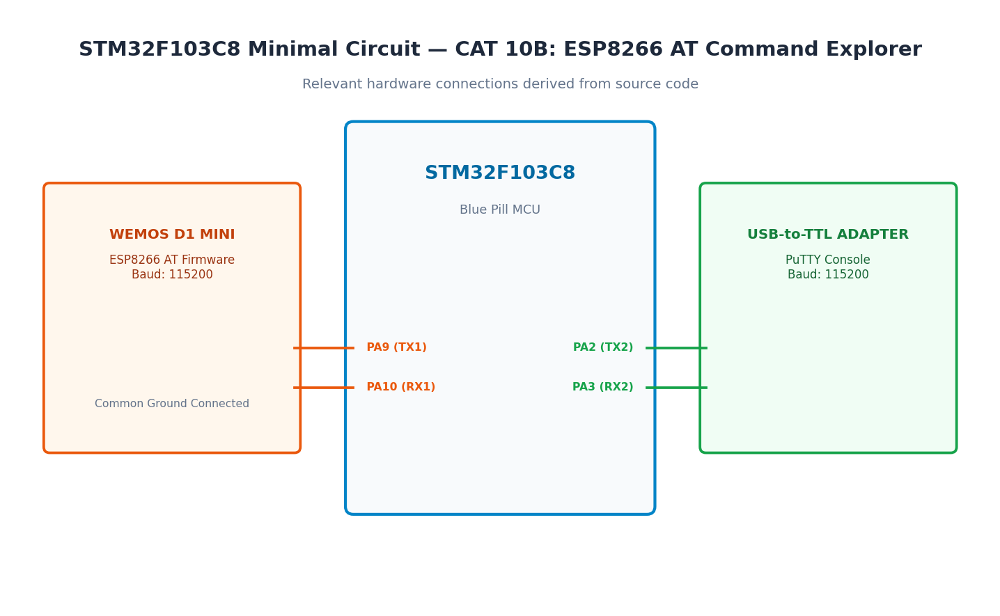
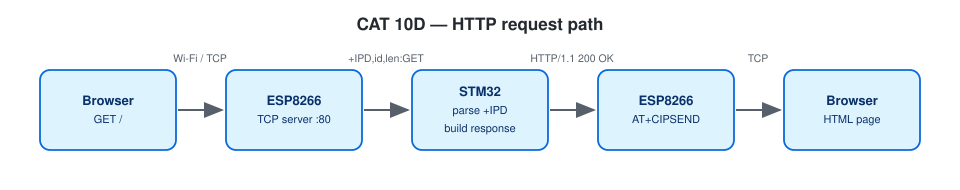

# EXPERIMENT DETAILS

**EXP:** CONTINUOUS ASSESSMENT 10

**DATE:** 05/10/2026 (Tasks 10C/10d: 12/10/2026)

**NAME OF EXP:** STM32–Wemos Wi-Fi Modem Interface Using AT Commands + HTTP Server

**HARDWARE SETUP / PLATFORM:** Blue Pill STM32F103C8T6 (ARM Cortex-M3, 72 MHz) + Wemos D1 mini (ESP8266 AT firmware) + USB-to-TTL serial adapter — STM32CubeMX + Keil MDK-ARM (STM32CubeIDE project included), STM32 HAL, PuTTY

---

## TASK 9B : Explore the ESP8266 AT Command Interface

> The CAT 10 handout calls this exercise **Task 9B**. Its project is under `TASK10B`.

### 1. Circuit Diagram

| STM32 Pin | Target Connection | Role |
|---|---|---|
| `PA9` (`USART1_TX`) | Wemos `RX` | Transmit AT commands to ESP8266 |
| `PA10` (`USART1_RX`) | Wemos `TX` | Receive AT responses from ESP8266 |
| `PA2` (`USART2_TX`) / `PA3` (`USART2_RX`) | USB-to-TTL `RX` / `TX` | Debug console to PC (PuTTY) |
| `GND` | Shared ground rail | Common reference |

Set `USART1` and `USART2` to **115200-8-N-1**. The firmware reads the Wi-Fi settings from `Core/Inc/wifi_secrets.h`, which Git ignores. See `wifi_config.h` for the macro definitions.






### 2. Core Logic / Pseudocode / Code Base

**How it works**

End each command to the ESP8266 with `\r\n`. The modem indicates the end of its reply with `OK`, `ERROR`, or `FAIL`.

| Operation | AT Command Syntax |
|---|---|
| Verify modem presence | `AT` |
| Query firmware version | `AT+GMR` |
| Select Wi-Fi Station mode | `AT+CWMODE=1` |
| Scan nearby access points | `AT+CWLAP` |
| Associate with an AP | `AT+CWJAP="ssid","pwd"` |
| Query IP and MAC addresses | `AT+CIFSR` |
| Open a TCP client socket | `AT+CIPSTART="TCP","host",port` |
| Transmit payload bytes | `AT+CIPSEND=<len>` |

**Pseudocode:**

1. Perform the initial modem handshake as in Task 10A.
2. Sequentially issue `AT`, `AT+GMR`, `AT+CWMODE=1`, and `AT+CWLAP`, buffering each multi-line response before printing it to `USART2`.
3. Display the summary reference table of AT commands on the terminal.
4. Enter interactive UART bridge mode.

**Code Base:**

- Keil project resources include `CAT10B_ESP8266_AT_Command_Explorer.ioc` (STM32CubeMX configuration), `MDK-ARM/CAT10B_ESP8266_AT_Command_Explorer.uvprojx` (Keil MDK), `.project` / `.cproject` (STM32CubeIDE); firmware entry point in `Core/Src/main.c`.
- Buffers full modem replies in a 1 KB RAM buffer prior to printing on `USART2` so incoming `USART1` bytes are never missed during console output

**Expected result**

```
>> AT+GMR
<< AT version:...
<< SDK version:...
<< OK
>> AT+CWLAP
<< +CWLAP:(3,"SNUC",-58,...)
<< OK
```

### 3. Inference

The same AT command helper reads the modem firmware details, enables station mode, and scans for nearby Wi-Fi networks.
