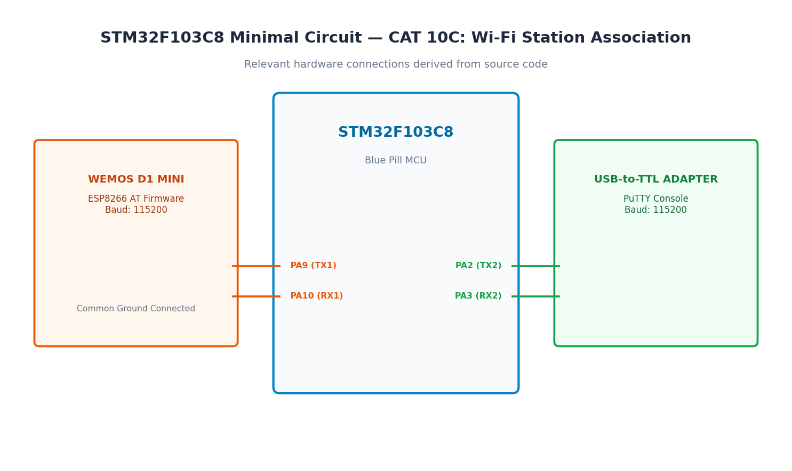

# EXPERIMENT DETAILS

**EXP:** CONTINUOUS ASSESSMENT 10

**DATE:** 05/10/2026 (Tasks 10C/10d: 12/10/2026)

**NAME OF EXP:** STM32–Wemos Wi-Fi Modem Interface Using AT Commands + HTTP Server

**HARDWARE SETUP / PLATFORM:** Blue Pill STM32F103C8T6 (ARM Cortex-M3, 72 MHz) + Wemos D1 mini (ESP8266 AT firmware) + USB-to-TTL serial adapter — STM32CubeMX + Keil MDK-ARM (STM32CubeIDE project included), STM32 HAL, PuTTY

---

## TASK 9C : Connect Wemos to Wi-Fi

> The CAT 10 handout calls this exercise **Task 9C**. Its project is under `TASK10C`.

### 1. Circuit Diagram

| STM32 Pin | Target Connection | Role |
|---|---|---|
| `PA9` (`USART1_TX`) | Wemos `RX` | Transmit AT commands to ESP8266 |
| `PA10` (`USART1_RX`) | Wemos `TX` | Receive AT responses from ESP8266 |
| `PA2` (`USART2_TX`) / `PA3` (`USART2_RX`) | USB-to-TTL `RX` / `TX` | Debug console to PC (PuTTY) |
| `GND` | Shared ground rail | Common reference |

Set `USART1` and `USART2` to **115200-8-N-1**. The firmware reads the Wi-Fi settings from `Core/Inc/wifi_secrets.h`, which Git ignores. See `wifi_config.h` for the macro definitions.




[View the data flow diagram](dataflow.svg)

### 2. Core Logic / Pseudocode / Code Base

**How it works**

The STM32 sets station mode with `AT+CWMODE=1`, joins the access point with `AT+CWJAP`, and reads the IPv4 and MAC addresses from the `STAIP,"…"` and `STAMAC,"…"` fields returned by `AT+CIFSR`. It checks outbound access by connecting to `example.com` with `AT+CIPSTART`, issuing an HTTP `GET` through `AT+CIPSEND`, and logging the HTTP status line.

**Pseudocode:**

1. Initialise the ESP8266 modem and disable command echo.
2. Set Station mode with `AT+CWMODE=1`.
3. Join the Wi-Fi network using `AT+CWJAP` (allowing up to a 20 s association timeout).
4. Issue `AT+CIFSR`, parse out the station IP and MAC strings, and print them on `USART2`.
5. Run the TCP client check: `AT+CIPSTART` → `AT+CIPSEND` → wait for `>` prompt → send HTTP request → print `HTTP/1.1 200 OK`.

**Code Base:**

- Keil project resources include `CAT10C_Connect_Wemos_to_WiFi.ioc` (STM32CubeMX configuration), `MDK-ARM/CAT10C_Connect_Wemos_to_WiFi.uvprojx` (Keil MDK), `.project` / `.cproject` (STM32CubeIDE); firmware entry point in `Core/Src/main.c`.
- `extract_after()` — string token extractor for `STAIP` and `STAMAC`
- `esp_wait_prompt()` and `tcp_demo()`

**Expected result**

```
Connected to Wifi Successfully
IP Address : 192.168.x.x
MAC Address: xx:xx:xx:xx:xx:xx
Server replied: HTTP/1.1 200 OK
```

### 3. Inference

The firmware handles Wi-Fi association and address discovery before checking outbound TCP and HTTP with `CIPSTART` and `CIPSEND`.
