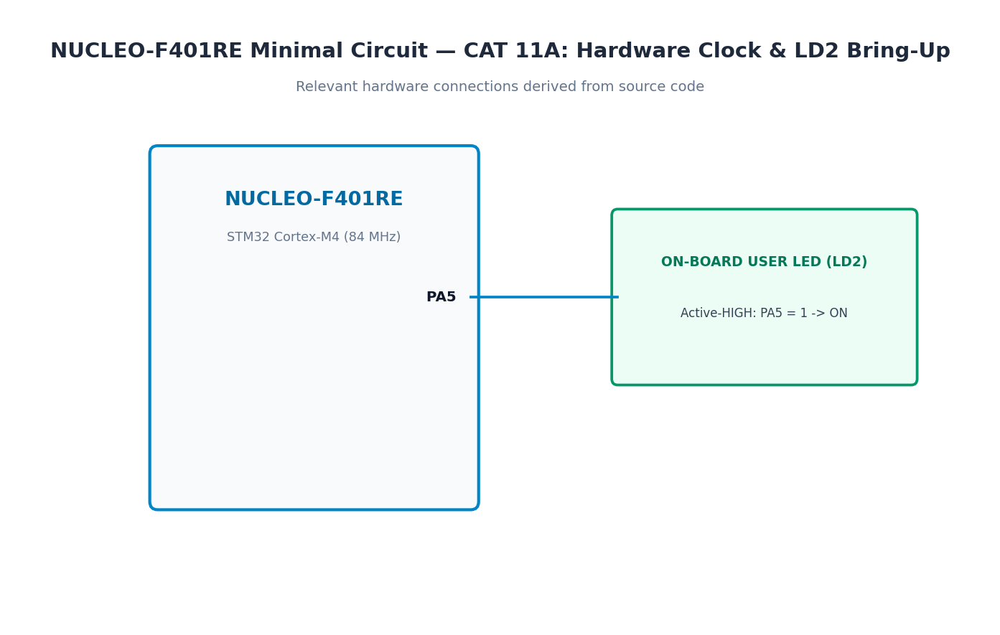

# EXPERIMENT DETAILS

**EXP:** CONTINUOUS ASSESSMENT 11

**DATE:** 14/10/2026

**NAME OF EXP:** STM32F401RE Cortex-M4: GPIO and User Input Programming

**HARDWARE SETUP / PLATFORM:** NUCLEO-F401RE (STM32F401RET6, ARM Cortex-M4F, 84 MHz) — STM32CubeMX + Keil MDK-ARM (STM32CubeIDE project included), STM32 HAL

---

## TASK 1 : On-board LED Bring-Up

### 1. Circuit Diagram

| Parameter | Hardware Details |
|---|---|
| Clock Source | No dedicated high-speed crystal on the target MCU; receives an 8 MHz clock from the on-board ST-LINK MCO (**HSE bypass** mode) |
| Microcontroller | STM32F401RET6, up to 84 MHz SYSCLK, 512 KB Flash, 96 KB SRAM |
| Available Peripherals | Ports GPIOA–GPIOD & GPIOH / 3× USART (1, 2, 6) / 3× I²C / 4× SPI |
| CubeMX PLL Tree | `8 MHz ÷ 4 × 84 ÷ 2 = 84 MHz` SYSCLK (`APB1 = 42 MHz`) |
| User LED (`LD2`) | `PA5`, **active-HIGH** |
| User Button (`B1`) | `PC13`, **active-LOW** |

### 2. Core Logic / Pseudocode / Code Base

**How it works**

On boot, call `HAL_RCC_GetSysClockFreq()` to read the CubeMX-configured `SYSCLK`. When the result is 84 MHz, toggle `LD2` (`PA5`) every 500 ms for a 1 Hz blink. A different result selects the 100 ms warning interval. Both intervals use non-blocking `HAL_GetTick()` timing.

**Pseudocode:**

1. Query `HAL_RCC_GetSysClockFreq()` and select the half-period interval (500 ms for 84 MHz, else 100 ms).
2. Initialise `LD2` (`PA5`) to OFF.
3. In the main loop, once the target interval has elapsed on `HAL_GetTick()`, invert `PA5` and record the new timestamp.

**Code Base:**

- Keil project resources include `CAT11_Task1_LED_BringUp.ioc` (STM32CubeMX configuration), `MDK-ARM/CAT11_Task1_LED_BringUp.uvprojx` (Keil MDK), `.project` / `.cproject` (STM32CubeIDE); firmware entry point in `Core/Src/main.c`.
- `sysclk_hz` (inspectable via debugger Live Expressions) and `blink_ms`

### 3. Inference

A 1 Hz blink on `LD2` indicates that the NUCLEO-F401RE is using the expected 84 MHz HSE-bypass PLL clock and that `PA5` works as an output.
