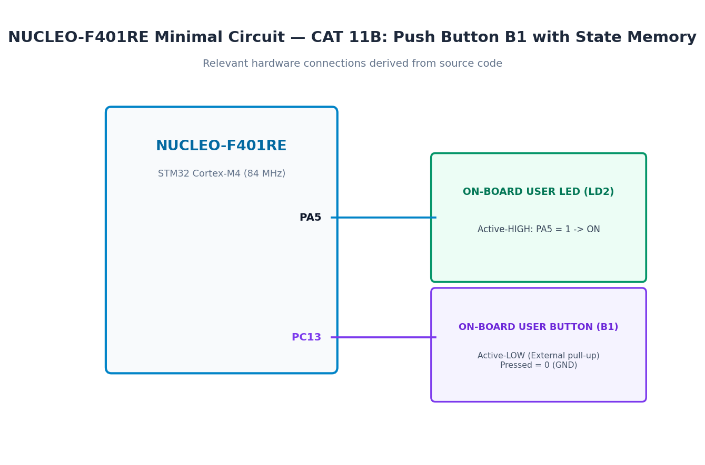

# EXPERIMENT DETAILS

**EXP:** CONTINUOUS ASSESSMENT 11

**DATE:** 14/10/2026

**NAME OF EXP:** STM32F401RE Cortex-M4: GPIO and User Input Programming

**HARDWARE SETUP / PLATFORM:** NUCLEO-F401RE (STM32F401RET6, ARM Cortex-M4F, 84 MHz) — STM32CubeMX + Keil MDK-ARM (STM32CubeIDE project included), STM32 HAL

---

## TASK 2 : On-board Switch Control with State Remembrance

### 1. Circuit Diagram

| Parameter | Hardware Details |
|---|---|
| Clock Source | No dedicated high-speed crystal on the target MCU; receives an 8 MHz clock from the on-board ST-LINK MCO (**HSE bypass** mode) |
| Microcontroller | STM32F401RET6, up to 84 MHz SYSCLK, 512 KB Flash, 96 KB SRAM |
| Available Peripherals | Ports GPIOA–GPIOD & GPIOH / 3× USART (1, 2, 6) / 3× I²C / 4× SPI |
| CubeMX PLL Tree | `8 MHz ÷ 4 × 84 ÷ 2 = 84 MHz` SYSCLK (`APB1 = 42 MHz`) |
| User LED (`LD2`) | `PA5`, **active-HIGH** |
| User Button (`B1`) | `PC13`, **active-LOW** |

### 2. Core Logic / Pseudocode / Code Base

**How it works**

Apply a 30 ms debounce filter to the active-low `B1` input on `PC13`. Each accepted press inverts `led_state` and writes it to `LD2` (`PA5`). Releasing the button leaves the stored state in place.

**Pseudocode:**

1. Sample and debounce `B1` (`PC13`) on every main-loop pass.
2. When a debounced press edge occurs: invert `led_state`, write the new level to `LD2`, and increment `press_count`.

**Code Base:**

- Keil project resources include `CAT11_Task2_Button_Toggle_State_Memory.ioc` (STM32CubeMX configuration), `MDK-ARM/CAT11_Task2_Button_Toggle_State_Memory.uvprojx` (Keil MDK), `.project` / `.cproject` (STM32CubeIDE); firmware entry point in `Core/Src/main.c`.
- `debounce_update()`, `ld2_write()`, `led_state`, and `press_count`

### 3. Inference

Software debouncing produces one toggle per press, and `led_state` stores the LED setting between presses.
