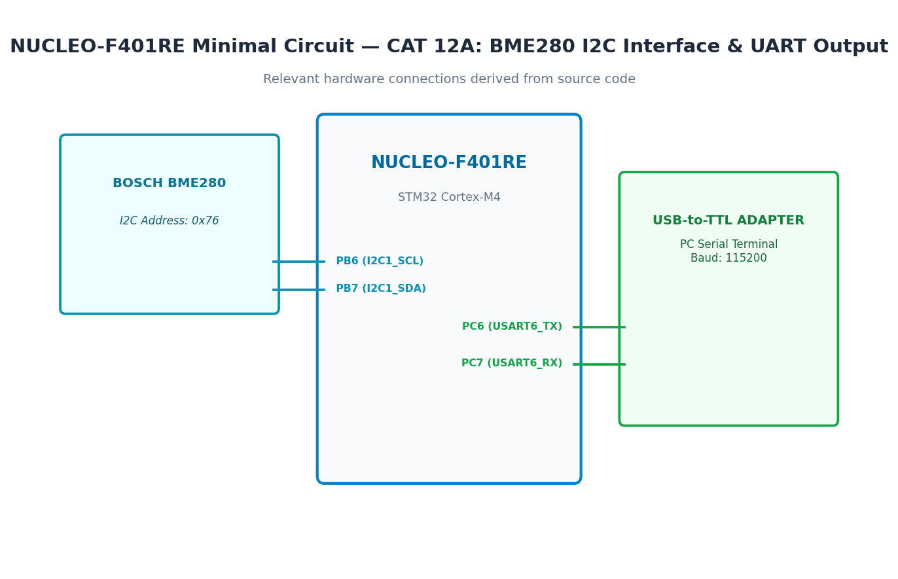
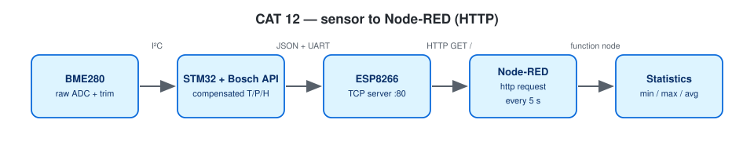

# EXPERIMENT DETAILS

**EXP:** CONTINUOUS ASSESSMENT 12

**DATE:** 23/10/2026

**NAME OF EXP:** BME280 Sensor Interfacing Using I²C and Bosch Sensor API, ESP8266 HTTP, Node Analytics

**HARDWARE SETUP / PLATFORM:** NUCLEO-F401RE (STM32F401RET6, ARM Cortex-M4F, 84 MHz) + Bosch BME280 + Wemos D1 mini + USB-to-TTL serial adapter — STM32CubeMX + Keil MDK-ARM (STM32CubeIDE project included), STM32 HAL, Bosch BME280 Sensor API v3.5.1, Node-RED

---

## STEP 1–3 : BME280 Interfacing with the Bosch Sensor API

### 1. Circuit Diagram

| Nucleo-F401RE Pin | Connected Peripheral |
|---|---|
| `PB6` (`I2C1_SCL`) / `PB7` (`I2C1_SDA`) | BME280 `SCL` / `SDA` (100 kHz standard-mode I²C) |
| `3V3` / `GND` | BME280 `VCC` / `GND`, with `SDO` tied to `GND` (I²C address `0x76`) |
| `PA9` (`USART1_TX`) / `PA10` (`USART1_RX`) | Wemos `RX` / `TX` (115200 baud, interrupt-driven RX) |
| `PC6` (`USART6_TX`) / `PC7` (`USART6_RX`) | USB-to-TTL adapter for PC debug console (115200 baud) |






### 2. Core Logic / Pseudocode / Code Base

**How it works**

Connect the Bosch driver to STM32 HAL through three callback pointers in `bme280_dev`. The implementation is in `Core/Src/bme280.c`, and the headers `bme280.h` and `bme280_defs.h` are under `Core/Inc`.

| Bosch API Callback | Application Wrapper | Underlying STM32 Mechanism |
|---|---|---|
| `read` | `user_i2c_read()` | `HAL_I2C_Mem_Read()` |
| `write` | `user_i2c_write()` | `HAL_I2C_Mem_Write()` |
| `delay_us` | `user_delay_us()` | `HAL_Delay()` for delays ≥ 1 ms; Cortex-M4 DWT cycle counter for sub-millisecond waits |

First check for chip ID `0x60` at register `0xD0`, then inspect the raw burst data at `0xF7`–`0xFE`. Apply the factory calibration through the Bosch API and print the compensated values on `USART6`. Switch between Profile A (`2×` oversampling, IIR off) and Profile B (`16×` oversampling, IIR coefficient 16) every ten samples.

**Pseudocode:**

1. Read I²C register `0xD0`; verify that it returns `0x60` (halting with a diagnostic message if not).
2. Call `bme_setup()`: populate `bme280_dev`, invoke `bme280_init()`, configure oversampling, IIR filter, and standby period, and switch the sensor to Normal mode.
3. Every 2 s: burst-read registers `0xF7`–`0xFE` and log the raw 20-bit/16-bit ADC counts.
4. Call `bme280_get_sensor_data()` to obtain compensated temperature (°C), pressure (Pa converted to hPa), and humidity (%RH), then print them.
5. Toggle between Profile A and Profile B after every 10 readings.

**Code Base:**

- Keil project resources include `CAT12A_BME280_I2C_UART.ioc` (STM32CubeMX configuration), `MDK-ARM/CAT12A_BME280_I2C_UART.uvprojx` (Keil MDK), `.project` / `.cproject` (STM32CubeIDE); firmware entry point in `Core/Src/main.c`.
- `read_chip_id()`, `print_raw()`, `apply_profile()`, `bme_setup()`, and `bme_read()`
- `fmt_fixed.h` — formats floating-point values using integer arithmetic (avoiding `-u _printf_float`)

**Expected result**

```
Chip ID     : 0x60 (BME280 OK)
--- Reading 1 (profile A) ---
Raw ADC     : T=... P=... H=...
Temperature : 28.45 °C
Pressure    : 1008.72 hPa
Humidity    : 62.30 %RH
```

### 3. Inference

Checking the `0x60` chip ID and reading the raw ADC data verifies the I²C path. The Bosch compensation routines convert those readings into temperature, pressure, and humidity measurements.
