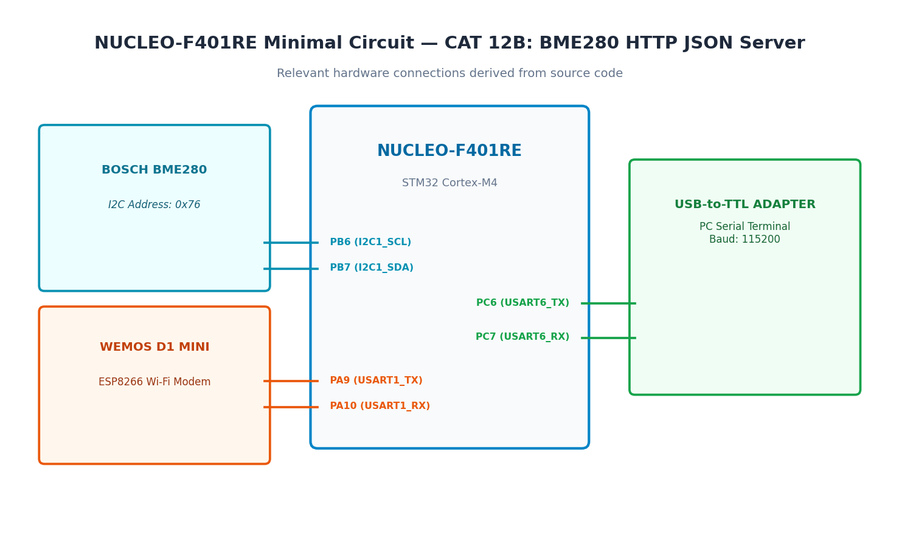

# EXPERIMENT DETAILS

**EXP:** CONTINUOUS ASSESSMENT 12

**DATE:** 23/10/2026

**NAME OF EXP:** BME280 Sensor Interfacing Using I²C and Bosch Sensor API, ESP8266 HTTP, Node Analytics

**HARDWARE SETUP / PLATFORM:** NUCLEO-F401RE (STM32F401RET6, ARM Cortex-M4F, 84 MHz) + Bosch BME280 + Wemos D1 mini + USB-to-TTL serial adapter — STM32CubeMX + Keil MDK-ARM (STM32CubeIDE project included), STM32 HAL, Bosch BME280 Sensor API v3.5.1, Node-RED

---

## TASK 12B : Raw HTTP Response with BME280 Data

### 1. Circuit Diagram

| Nucleo-F401RE Pin | Connected Peripheral |
|---|---|
| `PB6` (`I2C1_SCL`) / `PB7` (`I2C1_SDA`) | BME280 `SCL` / `SDA` (100 kHz standard-mode I²C) |
| `3V3` / `GND` | BME280 `VCC` / `GND`, with `SDO` tied to `GND` (I²C address `0x76`) |
| `PA9` (`USART1_TX`) / `PA10` (`USART1_RX`) | Wemos `RX` / `TX` (115200 baud, interrupt-driven RX) |
| `PC6` (`USART6_TX`) / `PC7` (`USART6_RX`) | USB-to-TTL adapter for PC debug console (115200 baud) |




[View the data flow diagram](dataflow.svg)

### 2. Core Logic / Pseudocode / Code Base

**How it works**

The `esp_at` driver joins Wi-Fi and starts an ESP8266 TCP server on port 80. For `GET /`, the STM32 converts the latest compensated BME280 readings to JSON and uses `strlen(json)` to get the response body length.

```
HTTP/1.1 200 OK
Content-Type: application/json
Content-Length: <calculated>
Access-Control-Allow-Origin: *
Connection: close

{"status":"success","temperature":28.45,"humidity":62.30,"pressure":1008.72}
```
The foreground loop uses `HAL_GetTick()` to schedule a sensor reading every two seconds. It serves HTTP requests one at a time through an `AT+CIPSEND` exchange with a timeout, typically taking a few tens of milliseconds per reply.

**Pseudocode:**

1. Initialise the BME280 sensor over I²C1.
2. Boot the ESP8266, connect to Wi-Fi, start the port-80 TCP server, and log the station URL.
3. In the main loop: process incoming modem URCs and reply to pending HTTP requests with the JSON payload (or `404`).
4. Every 2 s, sample fresh BME280 readings and print them on `USART6`.
5. Automatically re-establish the TCP server if a `WIFI DISCONNECT` occurs.

**Code Base:**

- Keil project resources include `CAT12B_BME280_HTTP_JSON_Server.ioc` (STM32CubeMX configuration), `MDK-ARM/CAT12B_BME280_HTTP_JSON_Server.uvprojx` (Keil MDK), `.project` / `.cproject` (STM32CubeIDE); firmware entry point in `Core/Src/main.c`.
- `build_json()`, `http_reply()`, `handle_request()`, and `server_start()`

**Expected result**

```
{"status":"success","temperature":28.45,"humidity":62.30,"pressure":1008.72}
```

### 3. Inference

The STM32 returns fresh BME280 readings as JSON over Wi-Fi using an HTTP/1.1 response whose `Content-Length` matches the payload.

---

## NEXT STEP : Node-RED Statistics

### 1. Circuit Diagram

| Nucleo-F401RE Pin | Connected Peripheral |
|---|---|
| `PB6` (`I2C1_SCL`) / `PB7` (`I2C1_SDA`) | BME280 `SCL` / `SDA` (100 kHz standard-mode I²C) |
| `3V3` / `GND` | BME280 `VCC` / `GND`, with `SDO` tied to `GND` (I²C address `0x76`) |
| `PA9` (`USART1_TX`) / `PA10` (`USART1_RX`) | Wemos `RX` / `TX` (115200 baud, interrupt-driven RX) |
| `PC6` (`USART6_TX`) / `PC7` (`USART6_RX`) | USB-to-TTL adapter for PC debug console (115200 baud) |


[View the data flow diagram](dataflow.svg)

### 2. Core Logic / Pseudocode / Code Base

**How it works**

In `NodeRED_CAT12_HTTP_Statistics_flow.json`, an `inject` node triggers `GET http://<STM32-IP>/` every five seconds through an `http request` node. The request node parses the reply as JSON. A `function` node keeps the minimum, maximum, running sum, and count in flow context and sends a summary table to the `debug` sidebar. A separate `inject` node clears the stored statistics.

**Pseudocode:**

1. Import `NodeRED_CAT12_HTTP_Statistics_flow.json` into Node-RED, enter the STM32's IP address in the `http request` node, and click **Deploy**.
2. Allow the flow to poll several samples and inspect the formatted min/max/average table in the Debug pane.

**Code Base:**

- `NodeRED_CAT12_HTTP_Statistics_flow.json`

**Expected result**

```
Parameter            Minimum  Maximum  Average
Temperature (°C)       27.91    29.02    28.46
Humidity (%RH)          59.8     64.2    62.15
Pressure (hPa)       1007.84  1009.31  1008.56
```

### 3. Inference

Node-RED reads the existing HTTP endpoint on a schedule and calculates the running minimum, maximum, and average in the flow.
