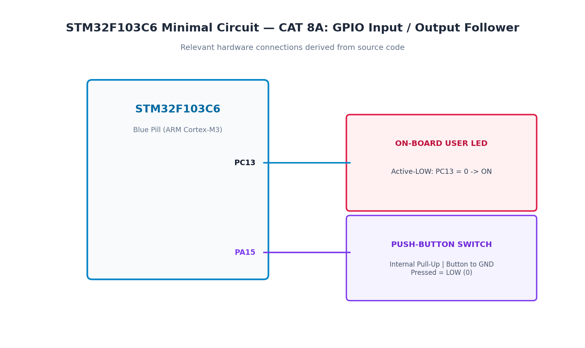

# EXPERIMENT DETAILS

**EXP:** CONTINUOUS ASSESSMENT 8

**DATE:** 18/09/2026

**NAME OF EXP:** STM32 GPIO Bring-Up and Switch-Controlled LED

**HARDWARE SETUP / PLATFORM:** Blue Pill STM32F103C6T6 (ARM Cortex-M3, 72 MHz) + push-button — STM32CubeMX + Keil MDK-ARM (STM32CubeIDE project included), STM32 HAL

---

## TASK 8A : GPIO Input/Output

### 1. Circuit Diagram

| Pin | CubeMX Mode | Hardware Connection |
|---|---|---|
| `PC13` | `GPIO_Output`, push-pull | On-board user LED (**active-LOW**) |
| `PA15` | `GPIO_Input`, internal pull-up | Tactile push-button switching to `GND` |
| `PA13` / `PA14` | `SYS`: Debug = Serial Wire (SWD) | ST-LINK debugger (releases `PA15` from JTAG `JTDI`) |
| `RCC` | 8 MHz HSE crystal → PLL ×9 | 72 MHz system clock |

### 2. Core Logic / Pseudocode / Code Base

**How it works**

The internal pull-up keeps `PA15` at `1` while the switch is open. Pressing the switch grounds the pin, producing `0`. The foreground loop calls `led_write(button_raw_pressed())` to mirror that state on the active-low `PC13` LED.

**Pseudocode:**

1. Run `HAL_Init()`, configure the 72 MHz system clock, and initialise GPIO pins.
2. Set the `PC13` LED to its initial OFF state (`GPIO_PIN_SET`).
3. Sample `PA15`: drive `PC13 = 0` (LED ON) while pressed, or `PC13 = 1` (LED OFF) while released.
4. Repeat continuously.

**Code Base:**

- Keil project resources include `CAT08A_GPIO_Input_Output.ioc` (STM32CubeMX configuration), `MDK-ARM/CAT08A_GPIO_Input_Output.uvprojx` (Keil MDK), `.project` / `.cproject` (STM32CubeIDE); firmware entry point in `Core/Src/main.c`.
- `button_raw_pressed()` — wraps `HAL_GPIO_ReadPin()`
- `led_write()` — wraps `HAL_GPIO_WritePin()` accounting for active-low polarity

### 3. Inference

When the onboard LED follows the button, the test exercises the CubeMX clock setup, the pull-up input, and the active-low GPIO output.
