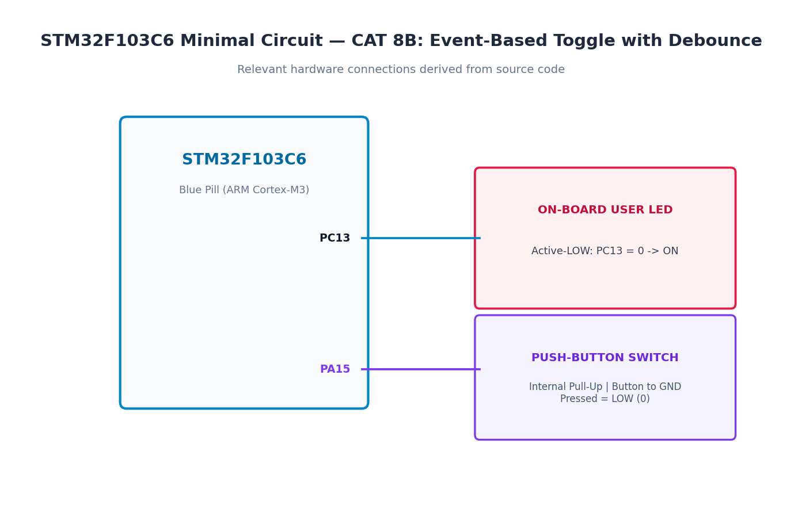

# EXPERIMENT DETAILS

**EXP:** CONTINUOUS ASSESSMENT 8

**DATE:** 18/09/2026

**NAME OF EXP:** STM32 GPIO Bring-Up and Switch-Controlled LED

**HARDWARE SETUP / PLATFORM:** Blue Pill STM32F103C6T6 (ARM Cortex-M3, 72 MHz) + push-button — STM32CubeMX + Keil MDK-ARM (STM32CubeIDE project included), STM32 HAL

---

## TASK 8B : Event-Based Control

### 1. Circuit Diagram

| Pin | CubeMX Mode | Hardware Connection |
|---|---|---|
| `PC13` | `GPIO_Output`, push-pull | On-board user LED (**active-LOW**) |
| `PA15` | `GPIO_Input`, internal pull-up | Tactile push-button switching to `GND` |
| `PA13` / `PA14` | `SYS`: Debug = Serial Wire (SWD) | ST-LINK debugger (releases `PA15` from JTAG `JTDI`) |
| `RCC` | 8 MHz HSE crystal → PLL ×9 | 72 MHz system clock |

### 2. Core Logic / Pseudocode / Code Base

**How it works**

A mechanical switch can change state several times as its contacts settle. `debounce_update()` uses `HAL_GetTick()` to accept a raw input change after it holds steady for 25 ms, then emits one `BTN_PRESS_EDGE` or `BTN_RELEASE_EDGE`. Only `BTN_PRESS_EDGE` toggles the LED.

**Pseudocode:**

1. Sample the raw GPIO pin state and current millisecond tick (`HAL_GetTick()`) on every iteration.
2. Whenever the raw level differs from the previous sample, reset the stability timestamp.
3. Once the raw level has stayed steady for 25 ms and differs from the committed state, update the committed state and emit the transition edge.
4. On `BTN_PRESS_EDGE`, invert `PC13` and increment `toggle_count`.

**Code Base:**

- Keil project resources include `CAT08B_Event_Toggle_Debounce.ioc` (STM32CubeMX configuration), `MDK-ARM/CAT08B_Event_Toggle_Debounce.uvprojx` (Keil MDK), `.project` / `.cproject` (STM32CubeIDE); firmware entry point in `Core/Src/main.c`.
- `debounce_t` state structure (`stable`, `last_raw`, `last_change`)
- `debounce_update()` — emits `BTN_PRESS_EDGE` / `BTN_RELEASE_EDGE`
- `HAL_GPIO_TogglePin()` and `toggle_count` (monitored via debugger Live Expressions)

### 3. Inference

The 25 ms filter gives one LED toggle per press and uses timestamps to keep the loop running during debounce.
