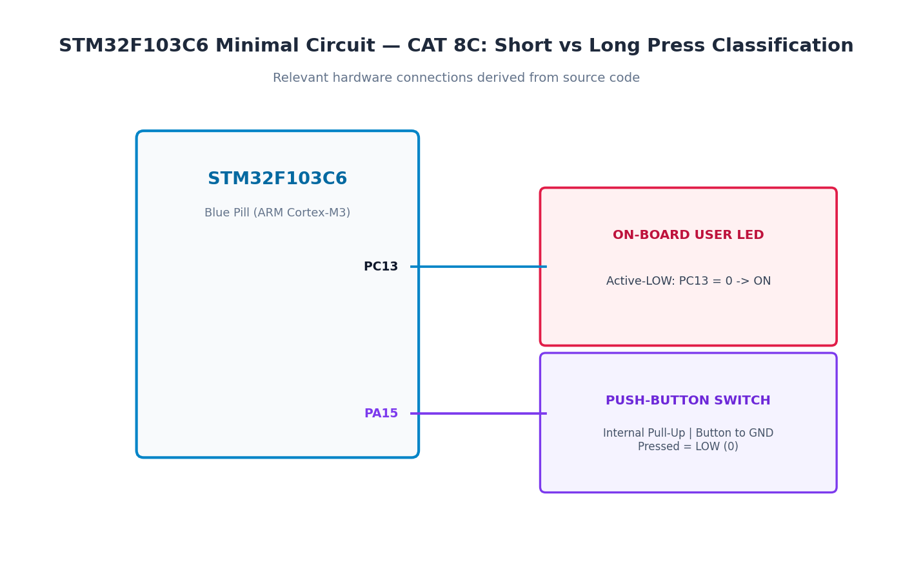

# EXPERIMENT DETAILS

**EXP:** CONTINUOUS ASSESSMENT 8

**DATE:** 18/09/2026

**NAME OF EXP:** STM32 GPIO Bring-Up and Switch-Controlled LED

**HARDWARE SETUP / PLATFORM:** Blue Pill STM32F103C6T6 (ARM Cortex-M3, 72 MHz) + push-button — STM32CubeMX + Keil MDK-ARM (STM32CubeIDE project included), STM32 HAL

---

## TASK 8C : Short Press vs Long Press

### 1. Circuit Diagram

| Pin | CubeMX Mode | Hardware Connection |
|---|---|---|
| `PC13` | `GPIO_Output`, push-pull | On-board user LED (**active-LOW**) |
| `PA15` | `GPIO_Input`, internal pull-up | Tactile push-button switching to `GND` |
| `PA13` / `PA14` | `SYS`: Debug = Serial Wire (SWD) | ST-LINK debugger (releases `PA15` from JTAG `JTDI`) |
| `RCC` | 8 MHz HSE crystal → PLL ×9 | 72 MHz system clock |

### 2. Core Logic / Pseudocode / Code Base

**How it works**

Save `press_start_ms` when the debounced press arrives. The loop keeps running until the release edge, then calculates `release_ms − press_start_ms`. A hold below 1 s counts as short. A hold of at least 1 s counts as long and starts continuous blinking upon release.

| User Input | LED Behaviour |
|---|---|
| Short press (< 1 s) | Toggle static LED state |
| Long press (≥ 1 s) | Enter continuous 200 ms blinking mode |
| Short press while blinking | Exit blinking mode |
| Subsequent long press | Re-enter blinking mode |

**Pseudocode:**

1. Latch `press_start_ms` on a debounced press edge.
2. Compute hold duration on the subsequent release edge.
3. If hold duration ≥ 1000 ms (long press), set `blinking = 1`.
4. If hold duration < 1000 ms (short press), clear `blinking` if currently blinking; otherwise invert the LED.
5. While `blinking` is active, invert `PC13` every 200 ms using `HAL_GetTick()`.

**Code Base:**

- Keil project resources include `CAT08C_Short_vs_Long_Press.ioc` (STM32CubeMX configuration), `MDK-ARM/CAT08C_Short_vs_Long_Press.uvprojx` (Keil MDK), `.project` / `.cproject` (STM32CubeIDE); firmware entry point in `Core/Src/main.c`.
- `classify_press()`
- Non-blocking `HAL_GetTick()` timestamps used for both hold measurement and blink pacing (zero `HAL_Delay()` calls)

### 3. Inference

The same `HAL_GetTick()` time base measures button holds and schedules the 200 ms LED blink while the loop continues to run.
