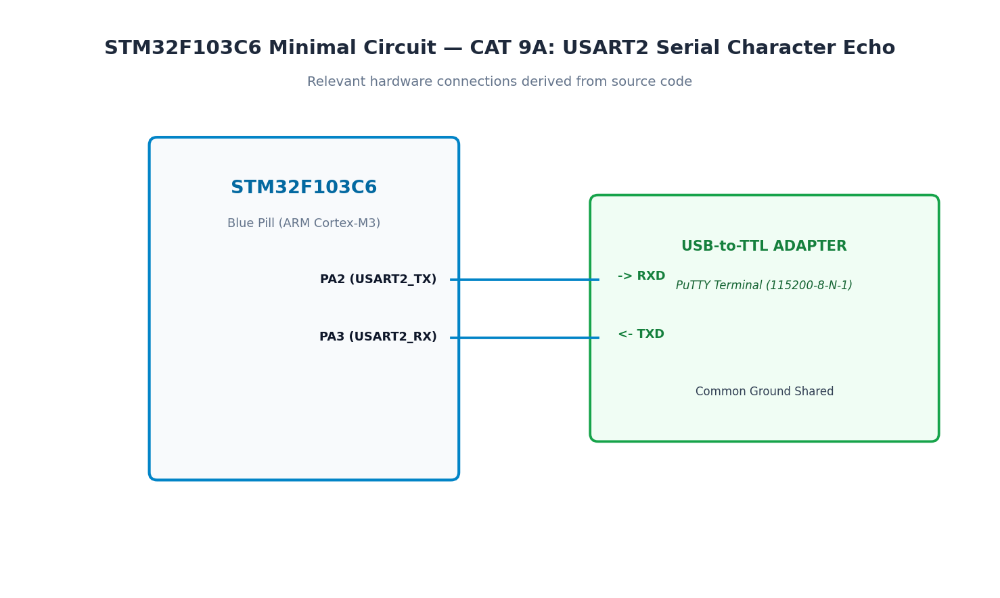

# EXPERIMENT DETAILS

**EXP:** CONTINUOUS ASSESSMENT 9

**DATE:** 28/09/2026

**NAME OF EXP:** STM32 UART Command Controlled LED

**HARDWARE SETUP / PLATFORM:** Blue Pill STM32F103C6T6 (ARM Cortex-M3, 72 MHz) + USB-to-TTL serial adapter + PuTTY — STM32CubeMX + Keil MDK-ARM (STM32CubeIDE project included), STM32 HAL, PuTTY

---

## TASK 9A : Basic UART Communication

### 1. Circuit Diagram

| STM32 Pin | USB-to-TTL Pin |
|---|---|
| `PA2` (`USART2_TX`) | `RX` |
| `PA3` (`USART2_RX`) | `TX` |
| `GND` | `GND` |

`USART2` configured in asynchronous mode at **115200-8-N-1**. On-board LED on `PC13`.




### 2. Core Logic / Pseudocode / Code Base

**How it works**

Poll `USART2` for a byte with `HAL_UART_Receive()` using a 10 ms timeout. Echo incoming bytes immediately. If `HAL_GetTick()` shows one second of serial inactivity, transmit `'A'` as a heartbeat.

**Pseudocode:**

1. Send the startup banner over `USART2`.
2. Poll `HAL_UART_Receive()` for 1 byte with a 10 ms timeout.
3. If a byte is received: echo it back (expanding `\r` to `\r\n`) and update the activity timestamp.
4. Otherwise, if 1000 ms have elapsed since the last activity, transmit `'A'` and update the timestamp.

**Code Base:**

- Keil project resources include `CAT09A_Basic_UART_Communication.ioc` (STM32CubeMX configuration), `MDK-ARM/CAT09A_Basic_UART_Communication.uvprojx` (Keil MDK), `.project` / `.cproject` (STM32CubeIDE); firmware entry point in `Core/Src/main.c`.
- `uart_send_str()` and `uart_send_char()`

**Expected result**

```
CAT9A - STM32 Blue Pill UART ready (115200-8-N-1)
AAAAhelloAAA
```

### 3. Inference

Recurring `'A'` characters test transmission, and immediate echo of typed characters exercises reception and transmission on `USART2` at 115200-8-N-1.
